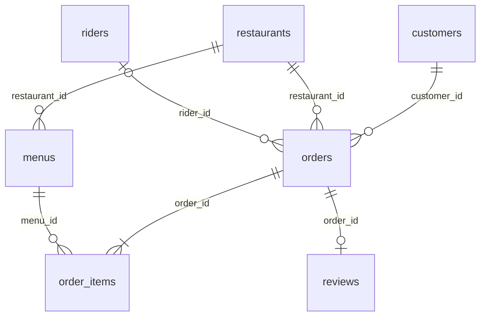

# DB-STUDY (MySQL & Java JDBC)

국비지원 과정(대한민국인공지능아카데미 11기)에서 진행한 MySQL 쿼리 실습(`Ch01` ~ `Ch07`)과 IntelliJ 기반 Java JDBC 연동 코드를 정리한 저장소입니다.

배달 플랫폼 예제 DB인 `hanip_delivery`(고객 30명, 가게 15곳, 메뉴 70개, 라이더 8명, 주문 563건, 주문상세 1,060건, 리뷰 260건)를 기반으로 테이블 조회, 집계, 조인, 서브쿼리, 윈도우 함수 실습을 진행했습니다.

---

## 개발 및 실습 환경

| 구분 | 사용 기술 | 비고 |
| :--- | :--- | :--- |
| DBMS | MySQL 8.0 / 9.x | `utf8mb4` |
| Tool | IntelliJ Database Tool, MySQL Workbench | 쿼리 작성 및 실행 계획/데이터 확인 |
| Language / Build | Java 21, Maven | JDBC 연동 실습 (`jdbc-practice`) |
| Library | `mysql-connector-j` (9.7.0), Lombok | `DriverManager`, `PreparedStatement`, `ResultSetMetaData` |

---

## 디렉토리 구조

```text
DBMS_STUDY/
├── database/                         # 한입배달 DB 스키마(schema.sql) 및 초기 데이터(seed.sql)
├── chapters/                         # 챕터별 교안, 문제(practice.md), 직접 작성한 쿼리(study01.sql)
│   ├── ch01-first-database/          # DB 기본 명령어 (SHOW, USE, DESC, LIMIT)
│   ├── ch02-select-basics/           # SELECT, WHERE 조건절, ORDER BY, LIMIT/OFFSET
│   ├── ch03-functions/               # 문자열·숫자·날짜 함수, CASE WHEN, IFNULL/COALESCE
│   ├── ch04-aggregation/             # 집계 함수, GROUP BY, HAVING, ROLLUP (study01.sql)
│   ├── ch05-join/                    # INNER JOIN, LEFT JOIN, 다중 조인 실습 (study01.sql)
│   ├── ch06-subquery-window/         # 서브쿼리, EXISTS, CTE(WITH), 윈도우 함수 실습 (study01.sql)
│   └── ch07-ddl-constraints/         # 테이블 설계(CREATE/ALTER) 및 제약조건(PK, FK, UNIQUE, CHECK)
└── jdbc-practice/                    # Java - MySQL JDBC 연동 및 공통 Repository 구현
    ├── pom.xml
    └── src/main/java/com/korai/dbstudy/
        ├── database/                 # DBConfig, DatabaseProvider(싱글톤), 연결 테스트
        ├── entity/                   # Menu, Customer 도메인 객체
        └── repository/               # ResultSetMetaData 기반 공통 Repository<T>
```

---

## 데이터베이스 구조 (ERD)

주문 데이터를 하나의 테이블에 몰아넣으면 데이터 중복과 수정 이상이 발생하므로, 역할에 따라 7개 테이블로 분리하고 PK-FK로 연결해 사용합니다.



---

# Part 1. MySQL 챕터별 정리 및 실습 쿼리

---

## Ch01. 데이터베이스 기본 탐색 (`ch01-first-database`)

### 정리
- **PK (Primary Key)**: 행을 고유하게 식별하는 컬럼 (중복 불가, `NULL` 불가)
- **FK (Foreign Key)**: 다른 테이블의 PK를 참조해 테이블 간 관계를 맺는 컬럼
- **SQL 분류**:
  - DML/DQL: `SELECT`, `INSERT`, `UPDATE`, `DELETE`
  - DDL: `CREATE`, `ALTER`, `DROP`, `TRUNCATE`
  - TCL: `COMMIT`, `ROLLBACK`
  - DCL: `GRANT`, `REVOKE`

### 기본 쿼리
```sql
SHOW DATABASES LIKE 'hanip_delivery%';
USE hanip_delivery01;
SELECT DATABASE() AS current_db;

SHOW TABLES;
DESC restaurants;

SELECT name, category, district
FROM restaurants
LIMIT 5;
```

---

## Ch02. `SELECT`와 조건 필터링 (`ch02-select-basics`)

### 정리
- **쿼리 작성 순서와 실제 실행 순서**:
  - 작성: `SELECT` -> `FROM` -> `WHERE` -> `ORDER BY` -> `LIMIT`
  - 실행: `FROM` -> `WHERE` -> `SELECT` -> `ORDER BY` -> `LIMIT`
  - `SELECT` 절에서 정의한 별칭(`AS`)은 `WHERE` 절에서는 아직 생성되기 전이라 참조할 수 없고, `ORDER BY`에서는 사용할 수 있다.
- **조건절 작성 시 주의할 점**:
  1. `AND`가 `OR`보다 우선순위가 높기 때문에 두 연산자를 같이 쓸 때는 괄호로 먼저 묶어준다.
  2. `DATETIME` 컬럼을 날짜로 기간 조회할 때 `BETWEEN '2026-06-01' AND '2026-06-30'`으로 쓰면 `06-30 00:00:00`까지만 조회된다. `ordered_at >= '2026-06-01' AND ordered_at < '2026-07-01'` 형태로 작성하는 것이 안전하다.
  3. `NULL` 여부는 `=`이나 `!=`로 비교할 수 없으므로 `IS NULL`, `IS NOT NULL`을 사용한다.

### 예제 쿼리
```sql
-- 다중 조건 필터링 및 정렬
SELECT name, category, district, min_order_amount, delivery_fee
FROM restaurants
WHERE district IN ('부산진구', '수영구')
  AND is_open = TRUE
  AND min_order_amount <= 15000
ORDER BY delivery_fee ASC, min_order_amount ASC;

-- LIKE 패턴 검색과 NULL 체크
SELECT name, address FROM customers WHERE address LIKE '%전포동%';
SELECT name, phone, email FROM customers WHERE email IS NULL;

-- 페이징 (2페이지: 5개 건너뛰고 5개 조회)
SELECT menu_id, name, price
FROM menus
ORDER BY menu_id
LIMIT 5 OFFSET 5;
```

---

## Ch03. 내장 함수와 조건 분기 (`ch03-functions`)

### 정리
- **문자열 함수**:
  - `CONCAT`은 인자 중 하나라도 `NULL`이면 결과가 `NULL`이 된다. 구분자를 넣으면서 `NULL`을 무시하려면 `CONCAT_WS`를 사용한다.
  - 한글 글자 수를 셀 때는 바이트 수를 반환하는 `LENGTH()` 대신 `CHAR_LENGTH()`를 사용한다.
- **날짜 함수**:
  - `DATE_FORMAT(컬럼, '%Y-%m-%d %H:%i')`: 날짜 포맷 변환
  - `DATEDIFF(끝, 시작)`: 일수 차이 / `TIMESTAMPDIFF(단위, 시작, 끝)`: 분(`MINUTE`), 연도(`YEAR`) 등 지정 단위 차이 계산
- **NULL 처리 및 조건문**:
  - `IFNULL(컬럼, 대체값)`, `COALESCE(값1, 값2, ...)`, `NULLIF(값1, 값2)`
  - `IF(조건, 참, 거짓)`, `CASE WHEN ... THEN ... ELSE ... END`

### 예제 쿼리
```sql
-- 전화번호 마스킹 및 만 나이/연령대 계산
SELECT name,
       CONCAT(LEFT(phone, 4), '****', RIGHT(phone, 5)) AS masked_phone,
       birth_date,
       TIMESTAMPDIFF(YEAR, birth_date, '2026-06-30') AS age,
       CASE
           WHEN birth_date IS NULL THEN '미입력'
           ELSE CONCAT(FLOOR(TIMESTAMPDIFF(YEAR, birth_date, '2026-06-30') / 10) * 10, '대')
       END AS age_group
FROM customers;

-- 주문 시각과 배달 완료 시각의 차이(분)로 배달 상태 분류
SELECT order_id,
       TIMESTAMPDIFF(MINUTE, ordered_at, delivered_at) AS minutes,
       CASE
           WHEN TIMESTAMPDIFF(MINUTE, ordered_at, delivered_at) <= 30 THEN '빠름'
           WHEN TIMESTAMPDIFF(MINUTE, ordered_at, delivered_at) <= 60 THEN '보통'
           ELSE '지연'
       END AS speed
FROM orders
WHERE status = '배달완료';
```

---

## Ch04. 집계와 그룹화 (`ch04-aggregation`)

### 정리
- **`COUNT(*)` vs `COUNT(컬럼)`**: `COUNT(*)`는 `NULL`을 포함한 전체 행 수를 세고, `COUNT(컬럼)`을 쓰면 `NULL`을 제외한 행 수만 카운트한다.
- **`WHERE`와 `HAVING`의 차이**:
  - `WHERE`: `GROUP BY`로 묶기 전에 개별 행을 필터링 (집계 함수 사용 불가)
  - `HAVING`: `GROUP BY` 이후 그룹화된 결과에 대해 집계 조건으로 필터링
- **조건부 집계**: `COUNT(IF(조건, 1, NULL))` 또는 `COUNT(CASE WHEN 조건 THEN 1 END)`를 활용하면 `NULL`은 카운트되지 않는 성질을 이용해 특정 조건을 만족하는 행만 집계할 수 있다.

### 실습 및 연습문제 풀이 (`chapters/ch04-aggregation/study01.sql`)
```sql
-- 1. WITH ROLLUP과 UNION ALL을 이용한 합계 행 추가 비교
SELECT IFNULL(payment_method, '합계') AS payment_method,
       COUNT(*)                      AS delivery_orders,
       SUM(orders.delivery_fee)      AS fee_sum
FROM orders
WHERE status = '배달완료'
GROUP BY payment_method WITH ROLLUP
ORDER BY payment_method;

-- 2. [문제 3] 별점별 리뷰 수와 내용 없이 별점만 남긴 리뷰 수 집계
SELECT rating,
       COUNT(rating)                       AS review_count,
       COUNT(IF(content IS NULL, 1, NULL)) AS rating_only
FROM reviews
GROUP BY rating;

-- 3. [문제 8] 배달완료 30건 이상 단골 고객의 주문 수, 첫 주문일, 마지막 주문일
SELECT customer_id,
       COUNT(*)                                 AS order_count,
       DATE_FORMAT(MIN(ordered_at), '%Y-%m-%d') AS first_order,
       DATE_FORMAT(MAX(ordered_at), '%Y-%m-%d') AS last_order
FROM orders
WHERE status = '배달완료'
GROUP BY customer_id
HAVING COUNT(*) >= 30
ORDER BY order_count DESC, customer_id ASC
LIMIT 5;

-- 4. [문제 11] 라이더별 배달 완료 건수, 평균 배달 시간(분), 60분 초과 지연 건수 및 지연율(%)
SELECT rider_id,
       COUNT(delivered_at) AS deliveries,
       ROUND(AVG(TIMESTAMPDIFF(MINUTE, ordered_at, delivered_at)), 1) AS avg_minute,
       COUNT(CASE WHEN TIMESTAMPDIFF(MINUTE, ordered_at, delivered_at) > 60 THEN 1 END) AS late_count,
       ROUND(COUNT(CASE WHEN TIMESTAMPDIFF(MINUTE, ordered_at, delivered_at) > 60 THEN 1 END) / COUNT(*) * 100, 1) AS late_rate
FROM orders
WHERE status = '배달완료'
GROUP BY rider_id
ORDER BY deliveries DESC;

-- 5. [문제 12] 월별 결제 수단 건수 피벗(Pivot) 테이블
SELECT DATE_FORMAT(ordered_at, '%Y-%m') AS order_month,
       COUNT(CASE WHEN payment_method = '카드' THEN 1 END)     AS card,
       COUNT(CASE WHEN payment_method = '간편결제' THEN 1 END) AS easy_pay,
       COUNT(CASE WHEN payment_method = '계좌이체' THEN 1 END) AS transfer,
       COUNT(CASE WHEN payment_method = '현장결제' THEN 1 END) AS on_site,
       COUNT(*)                                                AS total
FROM orders
WHERE status = '배달완료'
GROUP BY DATE_FORMAT(ordered_at, '%Y-%m');
```

---

## Ch05. JOIN (`ch05-join`)

### 정리
- **`INNER JOIN`**: 양쪽 테이블에서 조인 조건(`ON`)이 일치하는 행만 결합한다.
- **`LEFT OUTER JOIN`**: 왼쪽 기준 테이블의 데이터는 모두 유지하고, 오른쪽 테이블에 매칭되는 값이 없으면 `NULL`로 채운다.
  - 오른쪽 테이블의 PK가 `NULL`인 조건(`WHERE oi.menu_id IS NULL`)을 걸면 **한 번도 주문되지 않은 메뉴**나 **리뷰가 작성되지 않은 주문**을 찾을 수 있다.
  - 기준 테이블의 전체 건수(0건 포함)를 유지하면서 조건을 걸어야 할 때는 `WHERE`가 아니라 `LEFT JOIN ... ON` 절 안에 `AND`로 조건을 작성해야 기준 행이 사라지지 않는다.
- **조인 시 중복 집계 주의**: `orders`(1)와 `order_items`(N)를 조인하면 주문 1건이 상세 품목 수만큼 여러 줄로 늘어나므로, 주문 건수를 셀 때는 `COUNT(DISTINCT o.order_id)`를 사용한다.

### 실습 및 연습문제 풀이 (`chapters/ch05-join/study01.sql`)
```sql
-- 1. 6개 테이블 다중 LEFT JOIN으로 특정 고객의 주문/메뉴/리뷰/가게/라이더 이력 한 번에 조회
SELECT *
FROM orders o
    LEFT JOIN order_items oi ON oi.order_id = o.order_id
    LEFT JOIN menus m        ON m.menu_id = oi.menu_id
    LEFT JOIN reviews rb     ON rb.order_id = o.order_id
    LEFT JOIN customers c    ON c.customer_id = o.customer_id
    LEFT JOIN restaurants rt ON rt.restaurant_id = o.restaurant_id
    LEFT JOIN riders rd      ON rd.rider_id = o.rider_id
WHERE c.name = '윤지아';

-- 2. [문제 7] 업종별 배달완료 주문 수(중복 제거)와 음식 매출 합계
SELECT rs.category,
       COUNT(DISTINCT oi.order_id)      AS delivered_orders,
       SUM(oi.quantity * oi.unit_price) AS food_sales
FROM orders o
    JOIN restaurants rs ON rs.restaurant_id = o.restaurant_id
    JOIN order_items oi ON oi.order_id = o.order_id
WHERE status = '배달완료'
GROUP BY rs.category
ORDER BY food_sales DESC;

-- 3. [문제 8] LEFT JOIN + IS NULL을 이용해 한 번도 주문된 적 없는 메뉴 조회
SELECT ms.menu_id,
       ms.name,
       rs.name
FROM menus ms
    JOIN restaurants rs      ON rs.restaurant_id = ms.restaurant_id
    LEFT JOIN order_items oi ON oi.menu_id = ms.menu_id
WHERE oi.menu_id IS NULL
ORDER BY menu_id ASC;

-- 4. [문제 9] 전체 고객별 배달완료 주문 수 (0건인 고객도 누락되지 않도록 ON 절에 조건 추가)
SELECT cs.name,
       cs.grade,
       COUNT(os.order_id) AS delivered_orders
FROM customers cs
    LEFT JOIN orders os
           ON os.customer_id = cs.customer_id
          AND os.status = '배달완료'
GROUP BY cs.customer_id, cs.name, cs.grade
ORDER BY delivered_orders, cs.name ASC;

-- 5. [문제 11] 현재 메뉴 가격과 주문 당시 단가가 다른 메뉴(가격 변동 이력) 집계
SELECT ms.name,
       oi.unit_price,
       ms.price          AS current_price,
       SUM(oi.quantity)  AS sold_qty
FROM menus ms
    JOIN order_items oi ON oi.menu_id = ms.menu_id
    JOIN orders os      ON os.order_id = oi.order_id
WHERE status = '배달완료'
  AND oi.unit_price != ms.price
GROUP BY ms.name, oi.unit_price, ms.price, ms.menu_id
ORDER BY SUM(oi.quantity) DESC;
```

---

## Ch06. 서브쿼리·집합·윈도우 함수 (`ch06-subquery-window`)

### 정리
- **위치에 따른 서브쿼리 형태**:
  - **인라인 뷰 (`FROM` 절)**: 여러 행과 열을 가진 표 형태의 결과를 가상 테이블처럼 사용 (`FROM (SELECT ...) m`)
  - **목록 서브쿼리 (`WHERE` 절)**: 1개 컬럼의 여러 행을 반환해 `IN`, `NOT IN`, `EXISTS`와 함께 사용
  - **스칼라 서브쿼리 (`SELECT` / `WHERE` 절)**: 단일 값(1행 1열)을 반환해 컬럼 값이나 비교 조건으로 사용
- **`NOT IN` 사용 시 `NULL` 주의점**:
  - 서브쿼리 결과에 `NULL`이 하나라도 포함되어 있으면 `NOT IN` 조건 전체가 `UNKNOWN`이 되어 결과가 0건으로 나온다.
  - 따라서 서브쿼리 안에 `IS NOT NULL` 조건을 명시하거나, **`NOT EXISTS (SELECT 1 ...)`**를 사용하는 것이 안전하다.
- **CTE (`WITH` 절) & `UNION ALL`**:
  - 복잡한 집계 쿼리나 임시 코드성 테이블(요일 매핑 등)을 `WITH` 절로 분리해두면 본 쿼리에서 깔끔하게 `JOIN`해 재사용할 수 있다.
- **윈도우 함수 (`OVER`)**:
  - `GROUP BY`와 달리 행을 합치지 않고, 파티션(`PARTITION BY`) 내부에서의 순위(`RANK()`)나 순서(`ORDER BY`)에 따른 누적합(`SUM() OVER(...)`)을 계산한다.

### 실습 및 연습문제 풀이 (`chapters/ch06-subquery-window/study01.sql`)
```sql
-- 1. 인라인 뷰(FROM), 목록(IN), 스칼라(SELECT/WHERE) 서브쿼리 기본 형태
-- (1) FROM 절 인라인 뷰
SELECT *
FROM (SELECT menu_id, name AS menu_name FROM menus) m
WHERE menu_name LIKE '%국밥';

-- (2) WHERE 절 목록 서브쿼리
SELECT *
FROM order_items
WHERE menu_id IN (SELECT menu_id FROM menus WHERE menus.menu_id MOD 2 = 0);

-- (3) SELECT / WHERE 절 스칼라 서브쿼리
SELECT menu_id,
       name,
       (SELECT name FROM restaurants WHERE restaurants.restaurant_id = menus.restaurant_id) AS restaurant_name
FROM menus
WHERE restaurant_id = (SELECT restaurant_id FROM restaurants WHERE name = '장전동든든김밥');

-- 2. NOT IN의 NULL 문제 해결 vs NOT EXISTS 비교
-- (1) NOT IN 사용 시에는 서브쿼리에서 NULL을 반드시 제외해야 결과가 정상 출력됨
SELECT *
FROM riders
WHERE rider_id NOT IN (
    SELECT rider_id
    FROM orders
    WHERE ordered_at > '2026-06-30'
      AND orders.rider_id IS NOT NULL
);

-- (2) NOT EXISTS로 작성하면 NULL 신경 쓸 필요 없이 안전하게 동작
SELECT rd.name, rd.rider_id
FROM riders rd
WHERE NOT EXISTS (
    SELECT 1
    FROM orders o
    WHERE o.rider_id = rd.rider_id
      AND o.ordered_at >= '2026-06-30'
);

-- 3. WITH(CTE)와 UNION ALL 활용
-- (1) 가게별/월별 평균 주문금액을 CTE로 정의한 뒤 restaurants와 LEFT JOIN
WITH ap_cte AS (
    SELECT od.restaurant_id,
           DATE_FORMAT(ordered_at, '%Y-%m')     AS order_month,
           ROUND(AVG(quantity * unit_price), 0) AS avg_price
    FROM orders od
        LEFT OUTER JOIN order_items oi ON oi.order_id = od.order_id
    GROUP BY od.restaurant_id, DATE_FORMAT(ordered_at, '%Y-%m')
)
SELECT *
FROM restaurants rt
    LEFT JOIN ap_cte ap ON ap.restaurant_id = rt.restaurant_id;

-- (2) UNION ALL로 요일 번호(1~7) 한글 변환용 CTE를 만들어 주문 요일 출력
WITH day_of_week_kor AS (
    SELECT 1 AS day_id, '일' AS kor_name
    UNION ALL SELECT 2, '월'
    UNION ALL SELECT 3, '화'
    UNION ALL SELECT 4, '수'
    UNION ALL SELECT 5, '목'
    UNION ALL SELECT 6, '금'
    UNION ALL SELECT 7, '토'
)
SELECT order_id,
       ordered_at,
       dowk.kor_name
FROM orders od
    LEFT OUTER JOIN day_of_week_kor dowk ON dowk.day_id = DAYOFWEEK(od.ordered_at);

-- 4. 윈도우 함수 (RANK, 누적합 SUM OVER)
-- (1) 카테고리별 매출 기준 가게 순위 매기기 (PARTITION BY category)
SELECT rs.category,
       RANK() OVER (PARTITION BY category ORDER BY SUM(quantity * price) DESC) AS restaurant_rank,
       rs.restaurant_id,
       rs.name,
       IFNULL(SUM(oi.quantity), 0) AS total_quantity
FROM menus ms
    LEFT OUTER JOIN order_items oi ON oi.menu_id = ms.menu_id
    LEFT OUTER JOIN restaurants rs ON rs.restaurant_id = ms.restaurant_id
GROUP BY rs.restaurant_id, rs.category, rs.name
ORDER BY category ASC;

-- (2) 월별 배달비 합계와 월별 누적 배달비(SUM OVER) 구하기
SELECT DATE_FORMAT(ordered_at, '%Y-%m') AS order_month,
       SUM(IFNULL(delivery_fee, 0))     AS delivery_fee_sum,
       SUM(SUM(IFNULL(delivery_fee, 0))) OVER (ORDER BY DATE_FORMAT(ordered_at, '%Y-%m')) AS cumulative_fee
FROM orders
GROUP BY DATE_FORMAT(ordered_at, '%Y-%m');

-- 5. 연습문제 풀이 (문제 1, 5, 7)
-- [문제 1] 전체 메뉴 중 최고가 메뉴 조회
SELECT restaurant_id, name, price
FROM menus
WHERE price = (SELECT MAX(price) FROM menus);

-- [문제 5] 6월 이전에 가입했지만 6월 한 달간 주문 이력이 없는 고객 조회 (NOT EXISTS)
SELECT cs.name, cs.joined_at
FROM customers cs
WHERE DATE(cs.joined_at) < '2026-06-01'
  AND NOT EXISTS (
      SELECT 1
      FROM orders o1
      WHERE o1.customer_id = cs.customer_id
        AND o1.ordered_at >= '2026-06-01'
        AND o1.ordered_at < '2026-07-01'
  )
ORDER BY cs.joined_at;
```

---

## Ch07. 테이블 설계와 제약조건 (`ch07-ddl-constraints`)

### 정리
- **데이터 타입**:
  - 금액이나 할인율처럼 정확도가 중요한 숫자에는 부동소수점 오차가 있는 `FLOAT`/`DOUBLE` 대신 `INT`나 `DECIMAL`을 사용한다.
  - 고정 길이 문자열(전화번호 등)은 `CHAR`, 가변 길이 문자열은 `VARCHAR`를 사용한다.
- **주요 제약조건**:
  - `PRIMARY KEY`, `FOREIGN KEY`, `NOT NULL`, `UNIQUE`, `DEFAULT`, `CHECK`

---

# Part 2. Java JDBC 연동 실습 (`jdbc-practice`)

MySQL의 데이터를 Java 애플리케이션에서 조회하고 객체(`Menu`, `Customer`)로 변환하는 과정을 3단계로 나누어 작성했습니다.

### 1. 기본 `DriverManager` 연결 (`DBConnectionTest`, `DBConnectionTest2`)
- `try-with-resources` 구문을 사용해 쿼리 실행 후 `Connection`이 자동으로 반납되도록 처리
- `PreparedStatement`로 SQL을 실행하고 `ResultSet`의 커서를 `while (rs.next())`로 이동하며 `Customer`, `Menu` 객체 리스트 생성

### 2. 설정 분리 및 싱글톤 커넥션 (`DBConfig`, `DatabaseProvider`)
- 접속 정보(`URL`, `USERNAME`, `PASSWORD`)를 `DBConfig` 상수로 분리
- `DatabaseProvider`를 싱글톤 패턴으로 구성하여 필요할 때마다 `getConnection()`으로 커넥션 획득

### 3. `ResultSetMetaData`를 활용한 공통 `Repository<T>` 구현
- 테이블마다 반복되는 `ResultSet` 매핑 코드를 줄이기 위해, `Repository<T>` 인터페이스의 `default` 메서드(`select`, `selectOne`)에서 `ResultSetMetaData`로 컬럼명을 동적으로 읽어 `List<Map<String, Object>>` 형태로 반환하도록 작성
- 각 도메인 리포지토리(`MenuRepository`, `CustomerRepository`)에서는 반환된 `Map` 리스트를 Stream의 `.map(Menu::new)` 생성자 참조로 변환해 사용

```java
public interface Repository<T> {
    List<T> findAll();
    T findById(int id);

    default List<Map<String, Object>> select(Connection connection, String sql, List<Object> params) {
        try (Connection conn = connection;
             PreparedStatement pstmt = conn.prepareStatement(sql)) {

            if (params != null && !params.isEmpty()) {
                for (int i = 0; i < params.size(); i++) {
                    pstmt.setObject(i + 1, params.get(i));
                }
            }

            try (ResultSet rs = pstmt.executeQuery()) {
                List<Map<String, Object>> table = new ArrayList<>();
                ResultSetMetaData metaData = rs.getMetaData();
                int columnCount = metaData.getColumnCount();

                while (rs.next()) {
                    Map<String, Object> row = new LinkedHashMap<>();
                    for (int i = 0; i < columnCount; i++) {
                        int index = i + 1;
                        row.put(metaData.getColumnLabel(index), rs.getObject(index));
                    }
                    table.add(row);
                }
                return table;
            }
        } catch (SQLException e) {
            e.printStackTrace();
        }
        return null;
    }
}
```
