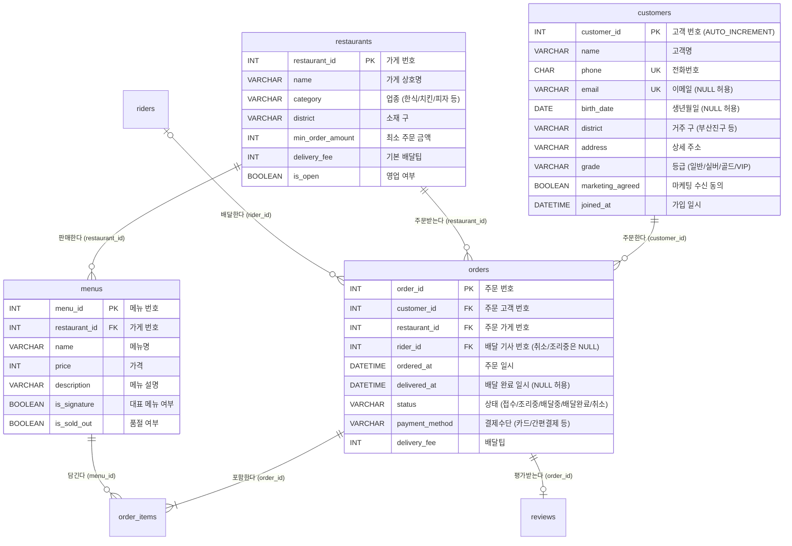
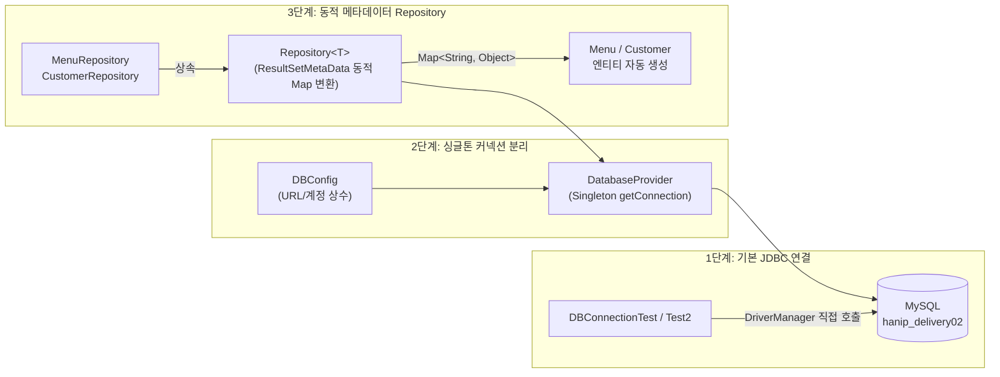

# 🗄️ DB-STUDY (MySQL & Java JDBC 프로젝트)

대한민국인공지능아카데미 11기 **MySQL 데이터베이스 기초·심화(`Ch01`~`Ch04`)부터 IntelliJ Java JDBC 연동 및 커스텀 ORM 매퍼(`Repository<T>`, `ResultSetMetaData`) 구현**까지 정리한 데이터베이스 종합 학습 & 실습 프로젝트 레포지토리입니다.

실제 배달 플랫폼 도메인인 **'한입배달(`hanip_delivery`)'** 데이터베이스(고객 30명 · 가게 15곳 · 메뉴 70개 · 라이더 8명 · 주문 563건 · 주문상세 1,060건 · 리뷰 260건)를 기반으로 SQL 데이터 분석과 Java 백엔드 DB 연동을 함께 다룹니다.

---

## 🛠 Tech Stack & Environment

| 항목 | 내용 | 비고 |
| :--- | :--- | :--- |
| **DBMS** | MySQL 8.0 / 9.x | `utf8mb4` 인코딩, 관계형 데이터베이스(RDBMS) |
| **DB Tool** | MySQL Workbench / IntelliJ Database Tool | 스키마 설계, ERD 확인, SQL 스크립트 실행 |
| **Language & Build** | Java 21 (LTS), Apache Maven | JDBC 연동 애플리케이션 (`jdbc-practice`) |
| **JDBC Library** | `mysql-connector-j` (9.7.0), Lombok (1.18.48) | `DriverManager`, `PreparedStatement`, `ResultSet`, `ResultSetMetaData` |
| **Architecture** | **Singleton + Generic Repository Pattern** | `DBConfig` ↔ `DatabaseProvider` ↔ `Repository<T>` ↔ `Entity` |

---

## 📁 Repository Structure

```text
DB-STUDY/
├── database/                                  # 🗄️ [한입배달 DB 스키마 & 초기 데이터 원본]
│   ├── schema.sql                             # 7개 핵심 테이블(customers, restaurants, menus 등) DDL
│   ├── seed.sql                               # 실전 샘플 데이터 (주문 563건, 상세 1,060건 등)
│   └── README.md                              # 데이터베이스 ERD 및 테이블 명세서
│
├── chapters/                                  # 📚 [MySQL 단계별 실습 커리큘럼 (Ch01 ~ Ch04)]
│   ├── ch01-first-database/                   # [Ch01] DB 기본 개념, SHOW / USE / DESC / LIMIT 탐색
│   │   ├── setup.sql                          # hanip_delivery01 DB 생성 스크립트
│   │   ├── lecture.sql / practice.md / answers.sql
│   │   └── README.md                          # Ch01 상세 교안
│   ├── ch02-select-basics/                    # [Ch02] SELECT, WHERE, 연산자, ORDER BY, LIMIT/OFFSET
│   │   ├── setup.sql                          # hanip_delivery02 DB 생성 스크립트
│   │   ├── lecture.sql / practice.md / answers.sql
│   │   └── README.md                          # Ch02 상세 교안
│   ├── ch03-functions/                        # [Ch03] 문자열·숫자·날짜 함수, CASE WHEN, IFNULL/COALESCE
│   │   ├── setup.sql                          # hanip_delivery03 DB 생성 스크립트
│   │   ├── lecture.sql / practice.md / answers.sql
│   │   └── README.md                          # Ch03 상세 교안
│   └── ch04-aggregation/                      # [Ch04] 집계 함수(COUNT/SUM/AVG), GROUP BY, HAVING, 조건부 집계
│       ├── setup.sql                          # hanip_delivery04 DB 생성 스크립트
│       ├── study01.sql                        # 직접 작성한 집계 & GROUP BY 실습 SQL 스크립트 ✨
│       ├── lecture.sql / practice.md / answers.sql
│       └── README.md                          # Ch04 상세 교안
│
├── jdbc-practice/                             # ☕ [IntelliJ Java ↔ MySQL JDBC 연동 프로젝트] 🌟
│   ├── pom.xml                                # Maven 설정 (mysql-connector-j, Lombok)
│   └── src/main/java/com/korai/dbstudy/
│       ├── database/                          # [DB 연결 설정 & 싱글톤 커넥션 공급자]
│       │   ├── DBConfig.java                  # 접속 URL, USERNAME, PASSWORD 상수 관리
│       │   ├── DatabaseProvider.java          # 싱글톤 패턴 기반 Connection 생성 공급자
│       │   ├── DBConnectionTest.java          # [실습 1] menus 테이블 기본 조회 및 Menu 객체 매핑
│       │   ├── DBConnectionTest2.java         # [실습 2] customers 테이블 조회 및 Customer 객체 매핑
│       │   └── DBConnectionTest03.java        # [실습 3] DatabaseProvider를 활용한 간결한 커넥션 연결
│       ├── entity/                            # [DB 테이블 매핑 도메인 엔티티]
│       │   ├── Menu.java                      # menus 테이블 엔티티 (Map<String, Object> 생성자 지원)
│       │   └── Customer.java                  # customers 테이블 엔티티 (Map<String, Object> 생성자 지원)
│       └── repository/                        # [제네릭 동적 매핑 Repository 계층]
│           ├── Repository.java                # ResultSetMetaData 기반 동적 Map 변환 공통 인터페이스
│           ├── MenuRepository.java            # menus 전체 조회(findAll) 및 단건 조회(findById)
│           └── CustomerRepository.java        # customers 전체/단건/이름 검색(findAllByLikename)
│
├── docs/                                      # 📖 커리큘럼 설계서(CURRICULUM.md) 및 SQL 작성 규칙(CONVENTIONS.md)
└── README.md                                  # 프로젝트 통합 문서
```

---

## 🗺️ 한입배달(`hanip_delivery`) 데이터베이스 ERD & 구조

하나의 엑셀 표에 모든 주문 정보를 적으면 데이터 중복과 수정 누락(이상 현상)이 발생합니다. 이를 해결하기 위해 **7개의 테이블로 역할을 나누고 기본키(PK)와 외래키(FK)로 연결**한 구조입니다.



---

# 📚 Part 1. MySQL 챕터별 핵심 개념 & 예제 쿼리 총정리 (`Ch01` ~ `Ch04`)

---

## 📌 Ch01. 데이터베이스와 첫 만남 (`ch01-first-database`)

### 1. 핵심 개념 요약
* **RDBMS(관계형 데이터베이스)**: 데이터를 행(Row, 레코드)과 열(Column, 속성)로 이루어진 **테이블(표)** 형태로 저장하고, 테이블 간의 관계를 **기본키(PK)**와 **외래키(FK)**로 연결해 관리하는 시스템.
* **기본키(Primary Key, PK)**: 행을 유일하게 식별하는 값 (중복 불가, `NULL` 불가 — 예: `customer_id`, `menu_id`).
* **외래키(Foreign Key, FK)**: 다른 테이블의 기본키를 참조하여 두 테이블을 연결하는 열 (예: `menus.restaurant_id` → `restaurants.restaurant_id`).
* **SQL 4대 분류**:
  1. **DQL / DML (데이터 조회·조작)**: `SELECT`(조회), `INSERT`(추가), `UPDATE`(수정), `DELETE`(삭제)
  2. **DDL (데이터 정의)**: `CREATE`(생성), `ALTER`(변경), `DROP`(삭제), `TRUNCATE`(초기화)
  3. **TCL (트랜잭션 제어)**: `COMMIT`(확정), `ROLLBACK`(취소)
  4. **DCL (권한 제어)**: `GRANT`(권한 부여), `REVOKE`(권한 회수)

### 2. 💻 핵심 예제 코드 (`lecture.sql`)
```sql
-- 1) 데이터베이스 목록 확인 및 작업할 DB 선택
SHOW DATABASES LIKE 'hanip_delivery%';
USE hanip_delivery01;
SELECT DATABASE() AS current_db; -- 현재 선택된 DB 확인

-- 2) 테이블 목록 및 테이블 설계도(구조) 확인
SHOW TABLES;
DESC restaurants;  -- Field(열 이름), Type(자료형), Null(빈값 허용 여부), Key(PRI/UNI/MUL) 확인

-- 3) 데이터 미리보기 (큰 테이블은 항상 LIMIT으로 개수 제한!)
SELECT * FROM restaurants LIMIT 5;
SELECT name, category, district FROM restaurants LIMIT 5;

-- 4) 자주 만나는 4대 에러 코드
-- Error 1046: No database selected       -> USE 데이터베이스명; 먼저 실행!
-- Error 1146: Table '...' doesn't exist  -> 테이블 이름 오타 (단수/복수 확인)
-- Error 1054: Unknown column '...'       -> 열 이름 오타 (DESC 테이블명; 으로 확인)
-- Error 1064: You have an error in your SQL syntax -> near '...' 바로 앞의 쉼표/따옴표/순서 확인
```

---

## 📌 Ch02. `SELECT` 기본 — 원하는 행과 열만 정확하게 (`ch02-select-basics`)

### 1. 핵심 개념 요약
* **논리적 실행 순서 (매우 중요!)**:
  * **작성 순서**: `SELECT` → `FROM` → `WHERE` → `ORDER BY` → `LIMIT`
  * **실제 DB 실행 순서**: **`① FROM` (테이블 선택) → `② WHERE` (행 필터링) → `③ SELECT` (열/별칭 생성) → `④ ORDER BY` (정렬) → `⑤ LIMIT` (개수 자르기)**
  * 💡 따라서 `SELECT`에서 만든 별칭(`AS`)은 그보다 먼저 실행되는 `WHERE`에서는 쓸 수 없고, 나중에 실행되는 `ORDER BY`에서만 쓸 수 있습니다!
* **핵심 연산자 주의사항**:
  1. **`AND`와 `OR` 혼용 시 괄호 필수**: `AND`가 `OR`보다 우선순위가 높으므로 `(A OR B) AND C`처럼 반드시 괄호로 묶어야 의도대로 동작합니다.
  2. **`DATETIME` 기간 검색**: `BETWEEN '2026-06-01' AND '2026-06-30'`으로 쓰면 `'2026-06-30 00:00:00'`까지만 포함되어 6월 30일 하루치 주문이 빠집니다. 반드시 **`ordered_at >= '2026-06-01' AND ordered_at < '2026-07-01'`** (반열린 구간)으로 작성합니다.
  3. **`NULL` 비교**: `NULL`은 `= NULL`이나 `<> NULL`로 비교할 수 없습니다(결과가 항상 알 수 없음). 반드시 **`IS NULL` / `IS NOT NULL`**을 사용합니다.

### 2. 💻 핵심 예제 코드 (`lecture.sql`)
```sql
-- 1) 계산식과 별칭(AS), 중복 제거(DISTINCT)
SELECT name AS menu_name,
       price AS current_price,
       price + 500 AS price_after_raise
FROM menus;

SELECT DISTINCT district, category FROM restaurants; -- 두 열의 조합이 중복되지 않게 조회

-- 2) WHERE 조건문: 괄호 우선순위, IN, LIKE, IS NULL
SELECT name, category, district, min_order_amount, delivery_fee
FROM restaurants
WHERE district IN ('부산진구', '수영구')      -- 부산진구 또는 수영구
  AND is_open = TRUE                        -- 영업 중이고
  AND min_order_amount <= 15000             -- 최소주문금액 15,000원 이하
ORDER BY delivery_fee ASC, min_order_amount ASC; -- 배달팁 싼 순 -> 같으면 최소주문금액 낮은 순

-- 3) 문자열 패턴(LIKE)과 NULL 체크
SELECT name, address FROM customers WHERE address LIKE '%전포동%'; -- '전포동'이 포함된 주소
SELECT name, phone, email FROM customers WHERE email IS NULL;     -- 이메일 미등록 고객

-- 4) 페이징 처리 (LIMIT & OFFSET)
-- 공식: LIMIT 페이지당개수 OFFSET (페이지번호 - 1) * 페이지당개수
SELECT menu_id, name, price
FROM menus
ORDER BY menu_id
LIMIT 5 OFFSET 5; -- 2페이지 (앞의 5개 건너뛰고 6번째부터 5개 조회)
```

---

## 📌 Ch03. 함수로 데이터 가공하기 (`ch03-functions`)

### 1. 핵심 개념 요약
* **문자열 함수**:
  * `CONCAT(a, b)`: 문자열 이어 붙이기 (단, 인자 중 하나라도 `NULL`이면 전체 결과가 `NULL`이 됨!)
  * `CONCAT_WS(구분자, a, b)`: 구분자를 넣어 이어 붙이기 (`NULL`은 알아서 건너뜀)
  * `CHAR_LENGTH(문자열)`: 실제 **글자 수** (`LENGTH()`는 바이트 수를 반환하므로 한글 1글자가 3바이트로 계산됨에 주의!)
  * `LEFT(s, n)` / `RIGHT(s, n)` / `SUBSTRING(s, 시작위치, 길이)` / `SUBSTRING_INDEX(s, 구분자, n)`
  * `REPLACE(s, 찾을문자, 바꿀문자)` / `LPAD(s, 총길이, 채울문자)`
* **숫자 함수**:
  * `ROUND(값, 자릿수)`(반올림), `TRUNCATE(값, 자릿수)`(버림 — 음수 자릿수 `-2`를 주면 100원 단위 손질), `CEIL()`(올림), `FLOOR()`(내림)
* **날짜·시간 함수**:
  * `DATE_FORMAT(날짜, '%Y-%m-%d %H:%i')`: 원하는 문자열 형식으로 변환 (분은 `%i`!)
  * `DATEDIFF(끝날짜, 시작날짜)`: 두 날짜 사이의 일수 차이
  * `TIMESTAMPDIFF(단위, 시작, 끝)`: `MINUTE`(분), `YEAR`(만 나이) 등 지정한 단위로 차이 계산
* **조건 & NULL 처리 함수**:
  * `IF(조건, 참일때값, 거짓일때값)` / `CASE WHEN 조건 THEN 결과 ... ELSE 기본값 END`
  * `IFNULL(열, 대체값)`: 열이 `NULL`이면 대체값 반환 (`COALESCE(a, b, c)`는 처음으로 `NULL`이 아닌 값 반환)
  * `NULLIF(분모, 0)`: 분모가 0이면 `NULL`로 만들어 0으로 나누기 에러 방지

### 2. 💻 핵심 예제 코드 (`lecture.sql`)
```sql
-- 1) 전화번호 마스킹(LEFT/RIGHT/CONCAT) + 만 나이(TIMESTAMPDIFF) + 연령대(CASE WHEN) + 가입 경과일(DATEDIFF)
SELECT name,
       CONCAT(LEFT(phone, 4), '****', RIGHT(phone, 5)) AS masked_phone, -- 010-****-5523
       birth_date,
       TIMESTAMPDIFF(YEAR, birth_date, '2026-06-30') AS age,            -- 생일 지난 여부까지 따진 만 나이
       CASE
           WHEN birth_date IS NULL THEN '미입력'
           ELSE CONCAT(FLOOR(TIMESTAMPDIFF(YEAR, birth_date, '2026-06-30') / 10) * 10, '대')
       END AS age_group,                                                -- 20대, 30대, 40대...
       DATEDIFF('2026-06-30', joined_at) AS days_since_join
FROM customers
ORDER BY customer_id;

-- 2) 배달 소요 시간(분) 및 속도 등급 분류
SELECT order_id,
       TIMESTAMPDIFF(MINUTE, ordered_at, delivered_at) AS minutes,
       CASE
           WHEN TIMESTAMPDIFF(MINUTE, ordered_at, delivered_at) <= 30 THEN '빠름'
           WHEN TIMESTAMPDIFF(MINUTE, ordered_at, delivered_at) <= 60 THEN '보통'
           ELSE '지연'
       END AS speed
FROM orders
WHERE status = '배달완료';

-- 3) NULL 안전 처리 (IFNULL, COALESCE)
SELECT name,
       IFNULL(email, '(미등록)') AS email_display,
       COALESCE(email, phone) AS primary_contact -- 이메일이 있으면 이메일, 없으면 전화번호
FROM customers;
```

---

## 📌 Ch04. 집계와 그룹 — 563건을 한 장의 리포트로 (`ch04-aggregation`)

### 1. 핵심 개념 요약
* **5대 집계 함수와 `NULL`의 관계**:
  * **`COUNT(*)`**: `NULL` 포함 전체 행의 개수를 셈.
  * **`COUNT(열)`**: 해당 열이 **`NULL`이 아닌** 행의 개수만 셈 (`COUNT(DISTINCT 열)`은 중복 제거 후 개수).
  * **`SUM()`, `AVG()`, `MIN()`, `MAX()`**: 모두 `NULL`을 건너뛰고 계산함! 단, 조건에 맞는 행이 0건이면 결과가 `NULL`이 되므로 **`IFNULL(SUM(...), 0)`**으로 감싸는 것이 안전함.
* **`GROUP BY`와 1055 에러 규칙**:
  * `GROUP BY`를 썼다면 `SELECT` 절에는 **① `GROUP BY`에 적은 열(식)** 또는 **② 집계 함수(`COUNT`, `SUM` 등)**만 올 수 있습니다! (묶음 안에 여러 개가 있는 일반 열을 그냥 적으면 `Error 1055` 발생 → 다 보고 싶으면 `GROUP_CONCAT()` 사용).
* **`WHERE` vs `HAVING` 완벽 구분**:
  * **`WHERE`**: 그룹으로 **묶기 전(②단계)** 개별 **행(Row)**을 거름 (집계 함수 사용 불가!).
  * **`HAVING`**: `GROUP BY`로 **묶은 후(④단계)** 집계된 **그룹(Group)**을 거름 (`HAVING COUNT(*) >= 50`).
* **조건부 집계 (`SUM(CASE WHEN ... THEN 1 ELSE 0 END)`)**:
  * 한 표 안에서 전체 주문 수, 배달완료 수, 취소 수, 취소율을 동시에 구할 때 사용.

### 2. 💻 핵심 예제 코드 ([`study01.sql`](file:///Users/kangminjae/Documents/gov/DB-STUDY/chapters/ch04-aggregation/study01.sql) & `lecture.sql`)
```sql
-- 1) 기본 집계 함수와 NULL 안전 합계 (study01.sql)
SELECT COUNT(*)      AS menu_count,
       MIN(price)    AS min_price,
       MAX(price)    AS max_price,
       SUM(price)    AS price_sum,
       AVG(price)    AS avg_price
FROM menus;

--COUNT(*) vs COUNT(컬럼) vs COUNT(DISTINCT 컬럼) 비교
SELECT COUNT(*)                         AS customers,      -- 전체 30명
       COUNT(customers.email)           AS with_email,     -- 이메일 있는 24명
       COUNT(customers.birth_date)      AS with_birth,     -- 생일 있는 27명
       COUNT(DISTINCT customers.district) AS districts     -- 서로 다른 거주 구 9개
FROM customers;

-- 주문이 0건인 가게의 합계가 NULL이 되지 않도록 IFNULL 처리
SELECT COUNT(*) AS orders,
       SUM(delivery_fee) AS fee_sum,
       IFNULL(SUM(delivery_fee), 0) AS fee_sum_safe
FROM orders
WHERE restaurant_id = 15;

-- 2) DISTINCT vs GROUP BY 비교 및 카테고리별 통계 (study01.sql)
SELECT category,
       COUNT(*) AS restaurants_count,
       MAX(delivery_fee) AS max_delivery_fee
FROM restaurants
GROUP BY category
ORDER BY restaurants_count DESC, category;

-- 3) WHERE(행 필터) + GROUP BY(그룹화) + HAVING(그룹 필터)
SELECT restaurant_id,
       COUNT(*) AS delivered_count
FROM orders
WHERE status = '배달완료'      -- ① 먼저 배달완료된 행만 추려낸 뒤
GROUP BY restaurant_id         -- ② 가게별로 묶고
HAVING COUNT(*) >= 50          -- ③ 묶인 결과 중 50건 이상인 가게만 선택!
ORDER BY delivered_count DESC;

-- 4) 실무 피벗 리포트: 월별 주문/완료/취소 건수 및 취소율 한 번에 구하기 (조건부 집계)
SELECT DATE_FORMAT(ordered_at, '%Y-%m') AS order_month,
       COUNT(*) AS total_orders,
       SUM(CASE WHEN status = '배달완료' THEN 1 ELSE 0 END) AS delivered,
       SUM(CASE WHEN status = '취소' THEN 1 ELSE 0 END) AS canceled,
       ROUND(SUM(CASE WHEN status = '취소' THEN 1 ELSE 0 END) * 100 / NULLIF(COUNT(*), 0), 1) AS cancel_rate,
       SUM(CASE WHEN status = '배달완료' THEN delivery_fee ELSE 0 END) AS fee_sum
FROM orders
GROUP BY order_month
ORDER BY order_month;
```

---

# ☕ Part 2. IntelliJ Java ↔ MySQL JDBC 연동 프로젝트 (`jdbc-practice`)

MySQL에 저장된 `hanip_delivery02` 데이터를 자바로 불러와 객체(`Menu`, `Customer`)로 변환하는 **3단계 진화 과정**을 구현했습니다.



---

## 📌 [1단계] 기본 JDBC 연결 & `ResultSet` 매핑 (`DBConnectionTest`, `DBConnectionTest2`)

### 핵심 원리
1. **접속 주소(URL) 포맷**: `jdbc:mysql://localhost:3306/hanip_delivery02`
2. **`try-with-resources` 자동 자원 반납**:
   * `try (Connection connection = DriverManager.getConnection(url, username, password))`
   * DB 커넥션은 유한한 자원이므로 사용 후 반드시 닫아주어야(`close()`) 다른 요청이 DB에 접속할 수 있습니다. `try(...)` 괄호 안에 선언하면 블록이 끝날 때 **자바가 자동으로 `close()`를 호출하여 커넥션 객체를 안전하게 소멸**시킵니다.
3. **`PreparedStatement` & `ResultSet` 커서 이동 (`while (rs.next())`)**:
   * `pstmt.executeQuery()`는 Workbench에서 번개 버튼을 눌러 SELECT 결과 표를 받아오는 것과 같습니다.
   * `rs.next()`는 결과 표에서 커서(화살표)를 **다음 행(Row)으로 한 칸 내리면서 데이터가 있으면 `true`, 더 이상 없으면 `false`를 반환**합니다.
   * 이때 `rs.getInt("컬럼명")`, `rs.getString("컬럼명")` 안에는 자바 변수명이 아니라 **MySQL 테이블의 실제 컬럼명(`customer_id`, `birth_date`, `joined_at`)**을 정확히 적어야 합니다!

### 💻 핵심 코드 ([`DBConnectionTest2.java`](file:///Users/kangminjae/Documents/gov/DB-STUDY/jdbc-practice/src/main/java/com/korai/dbstudy/database/DBConnectionTest2.java))
```java
String protocol = "jdbc:mysql";
String host = "localhost";
String port = "3306";
String username = "root";
String password = "1q2w3e4r!";
String databaseName = "hanip_delivery02";

// 1) "jdbc:mysql://localhost:3306/hanip_delivery02" URL 조립
String url = String.format("%s://%s:%s/%s", protocol, host, port, databaseName);
List<Customer> customers = new ArrayList<>();

// 2) try-with-resources로 Connection 자동 close 보장
try (Connection connection = DriverManager.getConnection(url, username, password)) {
    PreparedStatement pstmt = connection.prepareStatement("select * from customers");
    ResultSet rs = pstmt.executeQuery(); // 쿼리 실행 후 결과 표를 rs에 담음

    // 3) 다음 행(Row)이 있을 때까지 한 줄씩 내려가며 Customer 객체로 조립
    while (rs.next()) {
        Customer customer = new Customer(
                rs.getInt("customer_id"),     // DB 실제 컬럼명(snake_case) 사용!
                rs.getString("name"),
                rs.getString("phone"),
                rs.getString("email"),
                rs.getString("birth_date"),
                rs.getString("district"),
                rs.getString("address"),
                rs.getString("grade"),
                rs.getString("marketing_agreed"),
                rs.getString("joined_at")
        );
        customers.add(customer);
    }
} catch (SQLException e) {
    System.out.println("SQL서버 접속 실패");
    e.printStackTrace();
}

customers.forEach(System.out::println);
```

---

## 📌 [2단계] 설정 분리(`DBConfig`) & 싱글톤 커넥션 공급자(`DatabaseProvider`)

매번 모든 클래스마다 URL, 아이디, 비밀번호를 적으면 DB 정보가 바뀔 때 모든 파일을 다 고쳐야 합니다. 이를 **`DBConfig`(상수 클래스)**와 **`DatabaseProvider`(싱글톤 클래스)**로 분리했습니다.

### 💻 핵심 코드 ([`DBConfig.java`](file:///Users/kangminjae/Documents/gov/DB-STUDY/jdbc-practice/src/main/java/com/korai/dbstudy/database/DBConfig.java) & [`DatabaseProvider.java`](file:///Users/kangminjae/Documents/gov/DB-STUDY/jdbc-practice/src/main/java/com/korai/dbstudy/database/DatabaseProvider.java))
```java
// 1) DBConfig.java : 접속 정보를 상수로 한곳에서 관리
public class DBConfig {
    public static final String URL = "jdbc:mysql://localhost:3306/hanip_delivery02";
    public static final String USERNAME = "root";
    public static final String PASSWORD = "1q2w3e4r!";
}

// 2) DatabaseProvider.java : 싱글톤으로 어디서든 간편하게 Connection 대여
public class DatabaseProvider {
    private static DatabaseProvider instance;
    private String url;
    private String username;
    private String password;

    public static DatabaseProvider getInstance() {
        if (instance == null) {
            instance = new DatabaseProvider(DBConfig.URL, DBConfig.USERNAME, DBConfig.PASSWORD);
        }
        return instance;
    }

    public Connection getConnection() throws SQLException {
        return DriverManager.getConnection(url, username, password);
    }
}
```

---

## 📌 [3단계] `ResultSetMetaData` 기반 동적 매핑 `Repository<T>` 구현 🌟

`Menu`를 조회할 때와 `Customer`를 조회할 때마다 `try-catch`, `PreparedStatement`, `while(rs.next())` 코드를 매번 똑같이 반복 작성하는 문제를 해결하기 위해, **제네릭 인터페이스 `Repository<T>`의 `default` 메서드에서 `ResultSetMetaData`로 컬럼 이름과 값을 자동으로 읽어 `List<Map<String, Object>>`로 변환**하는 미니 ORM 엔진을 구현했습니다!

### 1. 핵심 동작 원리
1. **`?'` 바인딩 자동화**: `params` 리스트로 전달된 값들을 `pstmt.setObject(index, params.get(i))`로 `?` 자리에 순서대로 바인딩 (SQL 인덱스는 `1`번부터 시작!).
2. **`ResultSetMetaData` 동적 컬럼 추출**:
   * `rs.getMetaData().getColumnCount()`로 결과 표의 열 개수를 알아내고,
   * `metaData.getColumnLabel(index)`(컬럼명)를 Key로, `rs.getObject(index)`(값)를 Value로 하여 `Map<String, Object> row` 한 줄을 자동 생성합니다.
3. **Stream + 생성자 참조(`Menu::new`, `Customer::new`)**:
   * `Repository`가 돌려준 `List<Map<String, Object>>`를 `.stream().map(Menu::new).toList()`로 한 줄만에 엔티티 리스트로 변환합니다!

### 💻 핵심 코드 ([`Repository.java`](file:///Users/kangminjae/Documents/gov/DB-STUDY/jdbc-practice/src/main/java/com/korai/dbstudy/repository/Repository.java) & [`MenuRepository.java`](file:///Users/kangminjae/Documents/gov/DB-STUDY/jdbc-practice/src/main/java/com/korai/dbstudy/repository/MenuRepository.java) & [`CustomerRepository.java`](file:///Users/kangminjae/Documents/gov/DB-STUDY/jdbc-practice/src/main/java/com/korai/dbstudy/repository/CustomerRepository.java))
```java
// [1. Repository<T> 인터페이스 — 어떤 테이블이든 Map 리스트로 자동 변환!]
public interface Repository<T> {
    List<T> findAll();
    T findById(int id);

    default Map<String, Object> selectOne(Connection connection, String sql, List<Object> params) {
        return select(connection, sql, params).getFirst();
    }

    default List<Map<String, Object>> select(Connection connection, String sql, List<Object> params) {
        try (Connection conn = connection;
             PreparedStatement pstmt = conn.prepareStatement(sql)) {

            // 1) SQL의 '?' 자리에 파라미터 바인딩 (1번 인덱스부터 시작)
            if (params != null && !params.isEmpty()) {
                for (int i = 0; i < params.size(); i++) {
                    pstmt.setObject(i + 1, params.get(i));
                }
            }

            // 2) ResultSetMetaData로 컬럼명을 자동 추출하여 Map<컬럼명, 값> 생성
            try (ResultSet rs = pstmt.executeQuery()) {
                List<Map<String, Object>> table = new ArrayList<>();
                ResultSetMetaData metaData = rs.getMetaData();
                int columnCount = metaData.getColumnCount();

                while (rs.next()) {
                    Map<String, Object> row = new LinkedHashMap<>();
                    for (int i = 0; i < columnCount; i++) {
                        int index = i + 1;
                        row.put(metaData.getColumnLabel(index), rs.getObject(index));
                    }
                    table.add(row);
                }
                return table;
            }
        } catch (SQLException e) {
            e.printStackTrace();
        }
        return null;
    }
}
```

```java
// [2. MenuRepository & CustomerRepository — 단 몇 줄로 끝나는 DB 조회!]
public class MenuRepository implements Repository<Menu> {
    // 전체 메뉴 조회: Map 리스트를 받아 Stream의 map(Menu::new)로 즉시 변환!
    @Override
    public List<Menu> findAll() {
        String sql = "select * from menus";
        try {
            return select(databaseProvider.getConnection(), sql, null)
                    .stream()
                    .map(Menu::new)
                    .toList();
        } catch (SQLException e) {
            e.printStackTrace();
        }
        return List.of();
    }

    // 단건 메뉴 조회: menu_id = ? 자리에 List.of(id) 바인딩
    @Override
    public Menu findById(int id) {
        String sql = "select * from menus where menu_id = ?";
        try {
            Map<String, Object> row = selectOne(databaseProvider.getConnection(), sql, List.of(id));
            return new Menu(row);
        } catch (SQLException e) {
            e.printStackTrace();
        }
        return null;
    }
}
```

---

## 🚀 프로젝트 실행 방법

### 1. MySQL 데이터베이스 세팅
```sql
-- MySQL Workbench에서 각 챕터의 setup.sql 전체 실행 (Ctrl + Shift + Enter)
-- 예: chapters/ch02-select-basics/setup.sql 실행 시 hanip_delivery02 생성
SHOW DATABASES LIKE 'hanip_delivery%';
USE hanip_delivery02;
```

### 2. IntelliJ에서 Java JDBC 프로젝트(`jdbc-practice`) 실행
1. IntelliJ IDEA에서 `jdbc-practice` 폴더(또는 `pom.xml`) 열기
2. [`DBConfig.java`](file:///Users/kangminjae/Documents/gov/DB-STUDY/jdbc-practice/src/main/java/com/korai/dbstudy/database/DBConfig.java)의 MySQL 비밀번호 설정 확인
3. [`MenuRepository.java`](file:///Users/kangminjae/Documents/gov/DB-STUDY/jdbc-practice/src/main/java/com/korai/dbstudy/repository/MenuRepository.java) 또는 [`DBConnectionTest2.java`](file:///Users/kangminjae/Documents/gov/DB-STUDY/jdbc-practice/src/main/java/com/korai/dbstudy/database/DBConnectionTest2.java)의 `main()` 메서드 실행
