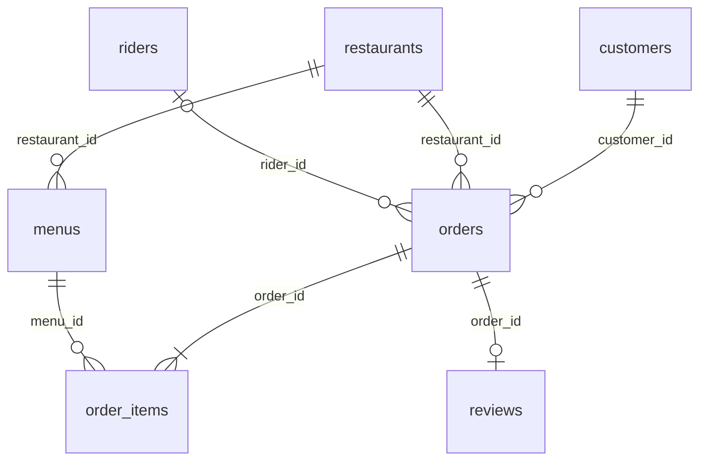

# DB-STUDY (MySQL & Java JDBC)

국비지원 과정(대한민국인공지능아카데미 11기)에서 진행한 MySQL 쿼리 실습(`Ch01` ~ `Ch10`, 쇼핑몰 종합 복습 문제집)과 IntelliJ 기반 Java JDBC 연동 코드를 정리한 저장소입니다.

배달 플랫폼 예제 DB인 `hanip_delivery`(고객 30명, 가게 15곳, 메뉴 70개, 라이더 8명, 주문 563건, 주문상세 1,060건, 리뷰 260건)와 쇼핑몰 예제 DB인 `hanip_market`(회원 100명, 상품 80개, 주문 800건 등)을 기반으로 테이블 조회, 집계, 조인, 서브쿼리, 윈도우 함수, DDL/제약조건, DML/트랜잭션, 정규화(1NF~BCNF), 뷰(VIEW)·인덱스(INDEX)·실행 계획(`EXPLAIN`) 실습을 진행했습니다.

---

## 개발 및 실습 환경

| 구분 | 사용 기술 | 비고 |
| :--- | :--- | :--- |
| DBMS | MySQL 8.0 / 9.x | `utf8mb4` |
| Tool | IntelliJ Database Tool, MySQL Workbench | 쿼리 작성 및 실행 계획/데이터 확인 |
| Language / Build | Java 21, Maven | JDBC 연동 실습 (`jdbc-practice`) |
| Library | `mysql-connector-j` (9.7.0), Lombok | `DriverManager`, `PreparedStatement`, `ResultSetMetaData` |

---

## 디렉토리 구조

```text
DBMS_STUDY/
├── database/                         # 한입배달 DB 스키마(schema.sql) 및 초기 데이터(seed.sql)
├── chapters/                         # 챕터별 교안, 문제(practice.md), 직접 작성한 쿼리(study.sql)
│   ├── ch01-first-database/          # DB 기본 명령어 (SHOW, USE, DESC, LIMIT)
│   ├── ch02-select-basics/           # SELECT, WHERE 조건절, ORDER BY, LIMIT/OFFSET
│   ├── ch03-functions/               # 문자열·숫자·날짜 함수, CASE WHEN, IFNULL/COALESCE
│   ├── ch04-aggregation/             # 집계 함수, GROUP BY, HAVING, ROLLUP (study01.sql)
│   ├── ch05-join/                    # INNER JOIN, LEFT JOIN, 다중 조인 실습 (study01.sql)
│   ├── ch06-subquery-window/         # 서브쿼리, EXISTS, CTE(WITH), 윈도우 함수 실습 (study01.sql)
│   ├── ch07-ddl-constraints/         # 테이블 설계(CREATE/ALTER) 및 제약조건 (study.sql)
│   ├── ch08-dml-transaction/         # INSERT/UPDATE/DELETE 및 트랜잭션 제어 (study.sql)
│   ├── ch09-modeling-normalization/  # 데이터 모델링, 정규화(1NF~BCNF), 반정규화 실습 (study01.sql)
│   ├── ch10-view-index-user/         # VIEW, B-Tree 인덱스, EXPLAIN 실행 계획, 권한 관리 (study01.sql)
│   ├── ch11-trigger/                 # 트리거(TRIGGER)를 활용한 이력 기록 및 무결성 검증
│   └── ch12-procedure/               # 저장 프로시저(PROCEDURE), 함수, 커서
├── drills/
│   └── shopping-mall/                # 한입마켓(hanip_market) 쇼핑몰 DB 20문항 종합 복습 (practice.sql)
├── project/                          # 2인 페어 DB 설계 미니 프로젝트 명세
└── jdbc-practice/                    # Java - MySQL JDBC 연동 및 공통 Repository 구현
    ├── pom.xml
    └── src/main/java/com/korai/dbstudy/
        ├── database/                 # DBConfig, DatabaseProvider(싱글톤), 연결 테스트
        ├── entity/                   # Menu, Customer 도메인 객체
        └── repository/               # ResultSetMetaData 기반 공통 Repository<T>
```

---

## 데이터베이스 구조 (ERD)

주문 데이터를 하나의 테이블에 몰아넣으면 데이터 중복과 수정 이상이 발생하므로, 역할에 따라 7개 테이블로 분리하고 PK-FK로 연결해 사용합니다.



---

# Part 1. MySQL 챕터별 정리 및 실습 쿼리

---

## Ch01. 데이터베이스 기본 탐색 (`ch01-first-database`)

### 정리
- **PK (Primary Key)**: 행을 고유하게 식별하는 컬럼 (중복 불가, `NULL` 불가)
- **FK (Foreign Key)**: 다른 테이블의 PK를 참조해 테이블 간 관계를 맺는 컬럼
- **SQL 분류**:
  - DML/DQL: `SELECT`, `INSERT`, `UPDATE`, `DELETE`
  - DDL: `CREATE`, `ALTER`, `DROP`, `TRUNCATE`
  - TCL: `COMMIT`, `ROLLBACK`
  - DCL: `GRANT`, `REVOKE`

### 기본 쿼리
```sql
SHOW DATABASES LIKE 'hanip_delivery%';
USE hanip_delivery01;
SELECT DATABASE() AS current_db;

SHOW TABLES;
DESC restaurants;

SELECT name, category, district
FROM restaurants
LIMIT 5;
```

---

## Ch02. `SELECT`와 조건 필터링 (`ch02-select-basics`)

### 정리
- **쿼리 작성 순서와 실제 실행 순서**:
  - 작성: `SELECT` -> `FROM` -> `WHERE` -> `ORDER BY` -> `LIMIT`
  - 실행: `FROM` -> `WHERE` -> `SELECT` -> `ORDER BY` -> `LIMIT`
  - `SELECT` 절에서 정의한 별칭(`AS`)은 `WHERE` 절에서는 아직 생성되기 전이라 참조할 수 없고, `ORDER BY`에서는 사용할 수 있다.
- **조건절 작성 시 주의할 점**:
  1. `AND`가 `OR`보다 우선순위가 높기 때문에 두 연산자를 같이 쓸 때는 괄호로 먼저 묶어준다.
  2. `DATETIME` 컬럼을 날짜로 기간 조회할 때 `BETWEEN '2026-06-01' AND '2026-06-30'`으로 쓰면 `06-30 00:00:00`까지만 조회된다. `ordered_at >= '2026-06-01' AND ordered_at < '2026-07-01'` 형태로 작성하는 것이 안전하다.
  3. `NULL` 여부는 `=`이나 `!=`로 비교할 수 없으므로 `IS NULL`, `IS NOT NULL`을 사용한다.

### 예제 쿼리
```sql
-- 다중 조건 필터링 및 정렬
SELECT name, category, district, min_order_amount, delivery_fee
FROM restaurants
WHERE district IN ('부산진구', '수영구')
  AND is_open = TRUE
  AND min_order_amount <= 15000
ORDER BY delivery_fee ASC, min_order_amount ASC;

-- LIKE 패턴 검색과 NULL 체크
SELECT name, address FROM customers WHERE address LIKE '%전포동%';
SELECT name, phone, email FROM customers WHERE email IS NULL;

-- 페이징 (2페이지: 5개 건너뛰고 5개 조회)
SELECT menu_id, name, price
FROM menus
ORDER BY menu_id
LIMIT 5 OFFSET 5;
```

---

## Ch03. 내장 함수와 조건 분기 (`ch03-functions`)

### 정리
- **문자열 함수**:
  - `CONCAT`은 인자 중 하나라도 `NULL`이면 결과가 `NULL`이 된다. 구분자를 넣으면서 `NULL`을 무시하려면 `CONCAT_WS`를 사용한다.
  - 한글 글자 수를 셀 때는 바이트 수를 반환하는 `LENGTH()` 대신 `CHAR_LENGTH()`를 사용한다.
- **날짜 함수**:
  - `DATE_FORMAT(컬럼, '%Y-%m-%d %H:%i')`: 날짜 포맷 변환
  - `DATEDIFF(끝, 시작)`: 일수 차이 / `TIMESTAMPDIFF(단위, 시작, 끝)`: 분(`MINUTE`), 연도(`YEAR`) 등 지정 단위 차이 계산
- **NULL 처리 및 조건문**:
  - `IFNULL(컬럼, 대체값)`, `COALESCE(값1, 값2, ...)`, `NULLIF(값1, 값2)`
  - `IF(조건, 참, 거짓)`, `CASE WHEN ... THEN ... ELSE ... END`

### 예제 쿼리
```sql
-- 전화번호 마스킹 및 만 나이/연령대 계산
SELECT name,
       CONCAT(LEFT(phone, 4), '****', RIGHT(phone, 5)) AS masked_phone,
       birth_date,
       TIMESTAMPDIFF(YEAR, birth_date, '2026-06-30') AS age,
       CASE
           WHEN birth_date IS NULL THEN '미입력'
           ELSE CONCAT(FLOOR(TIMESTAMPDIFF(YEAR, birth_date, '2026-06-30') / 10) * 10, '대')
       END AS age_group
FROM customers;

-- 주문 시각과 배달 완료 시각의 차이(분)로 배달 상태 분류
SELECT order_id,
       TIMESTAMPDIFF(MINUTE, ordered_at, delivered_at) AS minutes,
       CASE
           WHEN TIMESTAMPDIFF(MINUTE, ordered_at, delivered_at) <= 30 THEN '빠름'
           WHEN TIMESTAMPDIFF(MINUTE, ordered_at, delivered_at) <= 60 THEN '보통'
           ELSE '지연'
       END AS speed
FROM orders
WHERE status = '배달완료';
```

---

## Ch04. 집계와 그룹화 (`ch04-aggregation`)

### 정리
- **`COUNT(*)` vs `COUNT(컬럼)`**: `COUNT(*)`는 `NULL`을 포함한 전체 행 수를 세고, `COUNT(컬럼)`을 쓰면 `NULL`을 제외한 행 수만 카운트한다.
- **`WHERE`와 `HAVING`의 차이**:
  - `WHERE`: `GROUP BY`로 묶기 전에 개별 행을 필터링 (집계 함수 사용 불가)
  - `HAVING`: `GROUP BY` 이후 그룹화된 결과에 대해 집계 조건으로 필터링
- **조건부 집계**: `COUNT(IF(조건, 1, NULL))` 또는 `COUNT(CASE WHEN 조건 THEN 1 END)`를 활용하면 `NULL`은 카운트되지 않는 성질을 이용해 특정 조건을 만족하는 행만 집계할 수 있다.

### 실습 및 연습문제 풀이 (`chapters/ch04-aggregation/study01.sql`)
```sql
-- 1. WITH ROLLUP과 UNION ALL을 이용한 합계 행 추가 비교
SELECT IFNULL(payment_method, '합계') AS payment_method,
       COUNT(*)                      AS delivery_orders,
       SUM(orders.delivery_fee)      AS fee_sum
FROM orders
WHERE status = '배달완료'
GROUP BY payment_method WITH ROLLUP
ORDER BY payment_method;

-- 2. [문제 3] 별점별 리뷰 수와 내용 없이 별점만 남긴 리뷰 수 집계
SELECT rating,
       COUNT(rating)                       AS review_count,
       COUNT(IF(content IS NULL, 1, NULL)) AS rating_only
FROM reviews
GROUP BY rating;

-- 3. [문제 8] 배달완료 30건 이상 단골 고객의 주문 수, 첫 주문일, 마지막 주문일
SELECT customer_id,
       COUNT(*)                                 AS order_count,
       DATE_FORMAT(MIN(ordered_at), '%Y-%m-%d') AS first_order,
       DATE_FORMAT(MAX(ordered_at), '%Y-%m-%d') AS last_order
FROM orders
WHERE status = '배달완료'
GROUP BY customer_id
HAVING COUNT(*) >= 30
ORDER BY order_count DESC, customer_id ASC
LIMIT 5;

-- 4. [문제 11] 라이더별 배달 완료 건수, 평균 배달 시간(분), 60분 초과 지연 건수 및 지연율(%)
SELECT rider_id,
       COUNT(delivered_at) AS deliveries,
       ROUND(AVG(TIMESTAMPDIFF(MINUTE, ordered_at, delivered_at)), 1) AS avg_minute,
       COUNT(CASE WHEN TIMESTAMPDIFF(MINUTE, ordered_at, delivered_at) > 60 THEN 1 END) AS late_count,
       ROUND(COUNT(CASE WHEN TIMESTAMPDIFF(MINUTE, ordered_at, delivered_at) > 60 THEN 1 END) / COUNT(*) * 100, 1) AS late_rate
FROM orders
WHERE status = '배달완료'
GROUP BY rider_id
ORDER BY deliveries DESC;

-- 5. [문제 12] 월별 결제 수단 건수 피벗(Pivot) 테이블
SELECT DATE_FORMAT(ordered_at, '%Y-%m') AS order_month,
       COUNT(CASE WHEN payment_method = '카드' THEN 1 END)     AS card,
       COUNT(CASE WHEN payment_method = '간편결제' THEN 1 END) AS easy_pay,
       COUNT(CASE WHEN payment_method = '계좌이체' THEN 1 END) AS transfer,
       COUNT(CASE WHEN payment_method = '현장결제' THEN 1 END) AS on_site,
       COUNT(*)                                                AS total
FROM orders
WHERE status = '배달완료'
GROUP BY DATE_FORMAT(ordered_at, '%Y-%m');
```

---

## Ch05. JOIN (`ch05-join`)

### 정리
- **`INNER JOIN`**: 양쪽 테이블에서 조인 조건(`ON`)이 일치하는 행만 결합한다.
- **`LEFT OUTER JOIN`**: 왼쪽 기준 테이블의 데이터는 모두 유지하고, 오른쪽 테이블에 매칭되는 값이 없으면 `NULL`로 채운다.
  - 오른쪽 테이블의 PK가 `NULL`인 조건(`WHERE oi.menu_id IS NULL`)을 걸면 **한 번도 주문되지 않은 메뉴**나 **리뷰가 작성되지 않은 주문**을 찾을 수 있다.
  - 기준 테이블의 전체 건수(0건 포함)를 유지하면서 조건을 걸어야 할 때는 `WHERE`가 아니라 `LEFT JOIN ... ON` 절 안에 `AND`로 조건을 작성해야 기준 행이 사라지지 않는다.
- **조인 시 중복 집계 주의**: `orders`(1)와 `order_items`(N)를 조인하면 주문 1건이 상세 품목 수만큼 여러 줄로 늘어나므로, 주문 건수를 셀 때는 `COUNT(DISTINCT o.order_id)`를 사용한다.

### 실습 및 연습문제 풀이 (`chapters/ch05-join/study01.sql`)
```sql
-- 1. 6개 테이블 다중 LEFT JOIN으로 특정 고객의 주문/메뉴/리뷰/가게/라이더 이력 한 번에 조회
SELECT *
FROM orders o
    LEFT JOIN order_items oi ON oi.order_id = o.order_id
    LEFT JOIN menus m        ON m.menu_id = oi.menu_id
    LEFT JOIN reviews rb     ON rb.order_id = o.order_id
    LEFT JOIN customers c    ON c.customer_id = o.customer_id
    LEFT JOIN restaurants rt ON rt.restaurant_id = o.restaurant_id
    LEFT JOIN riders rd      ON rd.rider_id = o.rider_id
WHERE c.name = '윤지아';

-- 2. [문제 7] 업종별 배달완료 주문 수(중복 제거)와 음식 매출 합계
SELECT rs.category,
       COUNT(DISTINCT oi.order_id)      AS delivered_orders,
       SUM(oi.quantity * oi.unit_price) AS food_sales
FROM orders o
    JOIN restaurants rs ON rs.restaurant_id = o.restaurant_id
    JOIN order_items oi ON oi.order_id = o.order_id
WHERE status = '배달완료'
GROUP BY rs.category
ORDER BY food_sales DESC;

-- 3. [문제 8] LEFT JOIN + IS NULL을 이용해 한 번도 주문된 적 없는 메뉴 조회
SELECT ms.menu_id,
       ms.name,
       rs.name
FROM menus ms
    JOIN restaurants rs      ON rs.restaurant_id = ms.restaurant_id
    LEFT JOIN order_items oi ON oi.menu_id = ms.menu_id
WHERE oi.menu_id IS NULL
ORDER BY menu_id ASC;

-- 4. [문제 9] 전체 고객별 배달완료 주문 수 (0건인 고객도 누락되지 않도록 ON 절에 조건 추가)
SELECT cs.name,
       cs.grade,
       COUNT(os.order_id) AS delivered_orders
FROM customers cs
    LEFT JOIN orders os
           ON os.customer_id = cs.customer_id
          AND os.status = '배달완료'
GROUP BY cs.customer_id, cs.name, cs.grade
ORDER BY delivered_orders, cs.name ASC;

-- 5. [문제 11] 현재 메뉴 가격과 주문 당시 단가가 다른 메뉴(가격 변동 이력) 집계
SELECT ms.name,
       oi.unit_price,
       ms.price          AS current_price,
       SUM(oi.quantity)  AS sold_qty
FROM menus ms
    JOIN order_items oi ON oi.menu_id = ms.menu_id
    JOIN orders os      ON os.order_id = oi.order_id
WHERE status = '배달완료'
  AND oi.unit_price != ms.price
GROUP BY ms.name, oi.unit_price, ms.price, ms.menu_id
ORDER BY SUM(oi.quantity) DESC;
```

---

## Ch06. 서브쿼리·집합·윈도우 함수 (`ch06-subquery-window`)

### 정리
- **위치에 따른 서브쿼리 형태**:
  - **인라인 뷰 (`FROM` 절)**: 여러 행과 열을 가진 표 형태의 결과를 가상 테이블처럼 사용 (`FROM (SELECT ...) m`)
  - **목록 서브쿼리 (`WHERE` 절)**: 1개 컬럼의 여러 행을 반환해 `IN`, `NOT IN`, `EXISTS`와 함께 사용
  - **스칼라 서브쿼리 (`SELECT` / `WHERE` 절)**: 단일 값(1행 1열)을 반환해 컬럼 값이나 비교 조건으로 사용 (2행 이상 반환 시 `Error 1242` 발생)
- **`NOT IN` 사용 시 `NULL` 주의점**:
  - 서브쿼리 결과에 `NULL`이 하나라도 포함되어 있으면 `NOT IN` 조건 전체가 `UNKNOWN`이 되어 결과가 0건으로 나온다.
  - 따라서 서브쿼리 안에 `IS NOT NULL` 조건을 명시하거나, **`NOT EXISTS (SELECT 1 ...)`**를 사용하는 것이 안전하다.
- **CTE (`WITH` 절) & `UNION` / `UNION ALL`**:
  - `WITH 테이블명 AS (SELECT ...)`: 복잡한 집계 쿼리나 임시 코드성 테이블(요일 매핑 등)을 단계별로 이름 붙여 정의하고 본 쿼리에서 재사용할 수 있다.
  - `UNION`은 중복 행을 제거(느림), `UNION ALL`은 중복 제거 없이 위아래 결과를 그대로 합친다(빠름).
- **윈도우 함수 (`함수() OVER (PARTITION BY 그룹 ORDER BY 순서)`)**:
  - `GROUP BY`는 그룹마다 1행으로 합치지만, 윈도우 함수는 **원래 행들을 그대로 유지한 채** 옆에 그룹별 순위나 누적 합계를 붙인다.
  - **순위 함수 3가지 (`ROW_NUMBER`, `RANK`, `DENSE_RANK`) 동점 처리 비교**:

| 함수 | 동점 처리 방식 | 예시 결과 (`22000, 22000, 21000, 21000, 20000`) |
| :--- | :--- | :--- |
| `ROW_NUMBER()` | 동점이어도 무조건 고유 번호 부여 | `1, 2, 3, 4, 5` |
| `RANK()` | 동점은 같은 순위, 다음 순위는 동점 수만큼 건너뜀 | `1, 1, 3, 3, 5` |
| `DENSE_RANK()` | 동점은 같은 순위, 다음 순위를 건너뛰지 않음 | `1, 1, 2, 2, 3` |

  - **그룹별 Top-N 필터링**: 윈도우 함수는 `SELECT` 단계에서 계산되므로 `WHERE` 절에서 바로 조건으로 쓸 수 없다. `WITH`(CTE)나 인라인 뷰로 먼저 감싼 뒤 바깥 쿼리에서 `WHERE rn = 1` 형태로 거른다.
  - **집계 함수 + `OVER`**:
    - `SUM(SUM(금액)) OVER (ORDER BY 월)`: 안쪽 `SUM`은 `GROUP BY` 월별 합계이고, 바깥 `SUM() OVER`는 그 월별 합계를 순서대로 누적한다.
    - `SUM(SUM(금액)) OVER ()`: `OVER ()` 괄호를 비우면 전체 합계가 되어 전체 대비 비율(`%`)을 구할 때 사용한다.

### 윈도우 함수 핵심 예제 (`chapters/ch06-subquery-window/lecture.sql`)
```sql
-- 1. 순위 함수 3종 비교 (ROW_NUMBER vs RANK vs DENSE_RANK)
SELECT name,
       price,
       ROW_NUMBER() OVER (ORDER BY price DESC) AS row_num,
       RANK()       OVER (ORDER BY price DESC) AS rnk,
       DENSE_RANK() OVER (ORDER BY price DESC) AS dense_rnk
FROM menus
WHERE restaurant_id IN (1, 6)
ORDER BY price DESC, name;

-- 2. PARTITION BY: 가게별로 1위부터 다시 순위 매기기
SELECT restaurant_id,
       name,
       price,
       RANK() OVER (PARTITION BY restaurant_id ORDER BY price DESC) AS price_rank
FROM menus
WHERE restaurant_id IN (1, 2)
ORDER BY restaurant_id, price_rank;

-- 3. 그룹별 Top-N: CTE로 감싼 뒤 가게마다 가장 비싼 메뉴 1개씩 뽑기 (ROW_NUMBER)
WITH ranked AS (
    SELECT restaurant_id,
           name,
           price,
           ROW_NUMBER() OVER (PARTITION BY restaurant_id ORDER BY price DESC, menu_id) AS rn
    FROM menus
)
SELECT restaurant_id, name, price
FROM ranked
WHERE rn = 1
ORDER BY restaurant_id;

-- 4. 집계 함수 + OVER: 월별 배달비 합계, 누적 합계(ORDER BY), 전체 대비 비중(OVER ())
SELECT DATE_FORMAT(ordered_at, '%Y-%m') AS order_month,
       SUM(delivery_fee) AS fee_sum,
       SUM(SUM(delivery_fee)) OVER (ORDER BY DATE_FORMAT(ordered_at, '%Y-%m')) AS cumulative_fee,
       ROUND(SUM(delivery_fee) * 100 / SUM(SUM(delivery_fee)) OVER (), 1) AS share_pct
FROM orders
WHERE status = '배달완료'
GROUP BY order_month
ORDER BY order_month;
```

### 실습 및 연습문제 풀이 (`chapters/ch06-subquery-window/study01.sql`)
```sql
-- 1. 인라인 뷰(FROM), 목록(IN), 스칼라(SELECT/WHERE) 서브쿼리 기본 형태
-- (1) FROM 절 인라인 뷰
SELECT *
FROM (SELECT menu_id, name AS menu_name FROM menus) m
WHERE menu_name LIKE '%국밥';

-- (2) WHERE 절 목록 서브쿼리
SELECT *
FROM order_items
WHERE menu_id IN (SELECT menu_id FROM menus WHERE menus.menu_id MOD 2 = 0);

-- (3) SELECT / WHERE 절 스칼라 서브쿼리
SELECT menu_id,
       name,
       (SELECT name FROM restaurants WHERE restaurants.restaurant_id = menus.restaurant_id) AS restaurant_name
FROM menus
WHERE restaurant_id = (SELECT restaurant_id FROM restaurants WHERE name = '장전동든든김밥');

-- 2. NOT IN의 NULL 문제 해결 vs NOT EXISTS 비교
-- (1) NOT IN 사용 시에는 서브쿼리에서 NULL을 반드시 제외해야 결과가 정상 출력됨
SELECT *
FROM riders
WHERE rider_id NOT IN (
    SELECT rider_id
    FROM orders
    WHERE ordered_at > '2026-06-30'
      AND orders.rider_id IS NOT NULL
);

-- (2) NOT EXISTS로 작성하면 NULL 신경 쓸 필요 없이 안전하게 동작
SELECT rd.name, rd.rider_id
FROM riders rd
WHERE NOT EXISTS (
    SELECT 1
    FROM orders o
    WHERE o.rider_id = rd.rider_id
      AND o.ordered_at >= '2026-06-30'
);

-- 3. WITH(CTE)와 UNION ALL 활용
-- (1) 가게별/월별 평균 주문금액을 CTE로 정의한 뒤 restaurants와 LEFT JOIN
WITH ap_cte AS (
    SELECT od.restaurant_id,
           DATE_FORMAT(ordered_at, '%Y-%m')     AS order_month,
           ROUND(AVG(quantity * unit_price), 0) AS avg_price
    FROM orders od
        LEFT OUTER JOIN order_items oi ON oi.order_id = od.order_id
    GROUP BY od.restaurant_id, DATE_FORMAT(ordered_at, '%Y-%m')
)
SELECT *
FROM restaurants rt
    LEFT JOIN ap_cte ap ON ap.restaurant_id = rt.restaurant_id;

-- (2) UNION ALL로 요일 번호(1~7) 한글 변환용 CTE를 만들어 주문 요일 출력
WITH day_of_week_kor AS (
    SELECT 1 AS day_id, '일' AS kor_name
    UNION ALL SELECT 2, '월'
    UNION ALL SELECT 3, '화'
    UNION ALL SELECT 4, '수'
    UNION ALL SELECT 5, '목'
    UNION ALL SELECT 6, '금'
    UNION ALL SELECT 7, '토'
)
SELECT order_id,
       ordered_at,
       dowk.kor_name
FROM orders od
    LEFT OUTER JOIN day_of_week_kor dowk ON dowk.day_id = DAYOFWEEK(od.ordered_at);

-- 4. 윈도우 함수 실습 (RANK, ROW_NUMBER, 누적합 SUM OVER)
-- (1) 카테고리별 매출 기준 가게 순위 매기기 (RANK() OVER)
SELECT rs.category,
       RANK() OVER (PARTITION BY category ORDER BY SUM(quantity * price) DESC) AS restaurant_rank,
       rs.restaurant_id,
       rs.name,
       IFNULL(SUM(oi.quantity), 0) AS total_quantity
FROM menus ms
    LEFT OUTER JOIN order_items oi ON oi.menu_id = ms.menu_id
    LEFT OUTER JOIN restaurants rs ON rs.restaurant_id = ms.restaurant_id
GROUP BY rs.restaurant_id, rs.category, rs.name
ORDER BY category ASC;

-- (2) 월별 배달비 합계와 월별 누적 배달비(SUM OVER) 구하기
SELECT DATE_FORMAT(ordered_at, '%Y-%m') AS order_month,
       SUM(IFNULL(delivery_fee, 0))     AS delivery_fee_sum,
       SUM(SUM(IFNULL(delivery_fee, 0))) OVER (ORDER BY DATE_FORMAT(ordered_at, '%Y-%m')) AS cumulative_fee
FROM orders
GROUP BY DATE_FORMAT(ordered_at, '%Y-%m');

-- 5. 연습문제 풀이 (study01.sql)
-- [문제 1] 전체 메뉴 중 최고가 메뉴 조회
SELECT restaurant_id, name, price
FROM menus
WHERE price = (SELECT MAX(price) FROM menus);

-- [문제 5] 6월 이전에 가입했지만 6월 한 달간 주문 이력이 없는 고객 조회 (NOT EXISTS)
SELECT cs.name, cs.joined_at
FROM customers cs
WHERE DATE(cs.joined_at) < '2026-06-01'
  AND NOT EXISTS (
      SELECT 1
      FROM orders o1
      WHERE o1.customer_id = cs.customer_id
        AND o1.ordered_at >= '2026-06-01'
        AND o1.ordered_at < '2026-07-01'
  )
ORDER BY cs.joined_at;

-- [문제 8] 마지막 주문 이후 30일 이상 경과한 고객 조회
SELECT cs.name,
       MAX(o.ordered_at) AS last_order_date,
       TIMESTAMPDIFF(DAY, MAX(o.ordered_at), '2026-07-01') AS day_since_last
FROM orders o
    JOIN customers cs ON cs.customer_id = o.customer_id
WHERE o.ordered_at < '2026-07-01'
GROUP BY cs.customer_id, cs.name
HAVING day_since_last > 29
ORDER BY day_since_last DESC;

-- [문제 11] 업종별 가게 음식 매출 및 ROW_NUMBER() 순번 부여
SELECT rs.category,
       ROW_NUMBER() OVER (PARTITION BY rs.category ORDER BY SUM(oi.quantity * oi.unit_price) DESC) AS category_rn,
       rs.name,
       SUM(oi.quantity * oi.unit_price) AS food_sales
FROM orders os
    INNER JOIN restaurants rs ON rs.restaurant_id = os.restaurant_id
    INNER JOIN order_items oi ON oi.order_id = os.order_id
WHERE status = '배달완료'
GROUP BY rs.category, rs.name, rs.restaurant_id
ORDER BY food_sales DESC;
```

---

## Ch07. 테이블 설계와 제약조건 (`ch07-ddl-constraints`)

### 정리
- **데이터 타입 선택**:
  - 금액이나 할인율처럼 정확도가 중요한 숫자에는 2진수 부동소수점 오차가 발생하는 `FLOAT`/`DOUBLE`을 쓰지 않고 `INT`(원 단위)나 `DECIMAL(p, s)`을 사용한다.
  - 전화번호처럼 길이가 일정하고 사칙연산을 하지 않는 값(맨 앞 `0` 유지 필요)은 `CHAR(n)`, 가변 길이 문자열은 `VARCHAR(n)`(글자 수 기준), 긴 본문은 `TEXT`를 사용한다.
- **제약조건 6종과 주요 에러 코드**:
  - `PRIMARY KEY`: 행 식별자 (`NOT NULL` + `UNIQUE`, 보통 `AUTO_INCREMENT`와 함께 사용)
  - `NOT NULL`: 빈 값 허용 안 함 (위반 시 `Error 1048`)
  - `UNIQUE`: 중복 값 허용 안 함 (`NULL`은 여러 개 가능, 두 컬럼 이상을 묶어 복합 `UNIQUE` 지정 가능 — 위반 시 `Error 1062`)
  - `DEFAULT`: 값 생략 시 자동으로 채워질 기본값 (`DEFAULT 0`, `DEFAULT CURRENT_TIMESTAMP` 등)
  - `CHECK`: 허용할 값의 범위나 여러 컬럼 간 조건식 지정 (위반 시 `Error 3819`)
  - `FOREIGN KEY`: 부모 테이블에 존재하는 값만 참조 가능 (없는 부모 참조 시 `Error 1452`, 자식이 참조 중인 부모 삭제 시 `Error 1451`)
    - `ON DELETE` 정책: `RESTRICT`(기본값, 삭제 차단), `CASCADE`(자식 행도 연쇄 삭제), `SET NULL`(자식의 FK 값을 `NULL`로 변경)
- **제약조건 작성 위치**:
  - 단일 컬럼에만 간단히 걸 때는 컬럼 옆에 적을 수 있지만, 복합 `UNIQUE`를 걸거나 에러 메시지에서 어떤 규칙을 어겼는지 바로 확인하려면 아래쪽에 `CONSTRAINT 제약조건이름 ...` 형태로 이름을 붙여 작성한다.
- **`DELETE` vs `TRUNCATE` vs `DROP`**:

| 구문 | 분류 | 동작 | 되돌리기(Rollback) | `AUTO_INCREMENT` |
| :--- | :--- | :--- | :--- | :--- |
| `DELETE FROM t WHERE ...` | DML | 조건에 맞는 행 삭제 | 트랜잭션 내 가능 | 기존 번호 유지 |
| `TRUNCATE TABLE t` | DDL | 테이블 구조는 남기고 모든 행 초기화 | 불가 | 1로 초기화 |
| `DROP TABLE t` | DDL | 테이블 자체를 삭제 | 불가 | - |

### 실습 및 연습문제 풀이 (`chapters/ch07-ddl-constraints/study01.sql`)

#### 1. 쿠폰 종류(`coupons`) & 고객 보유 쿠폰(`customer_coupons`) 테이블 설계 및 조회
```sql
CREATE TABLE coupons (
    coupon_id        INT         NOT NULL AUTO_INCREMENT,
    code             VARCHAR(20) NOT NULL,
    name             VARCHAR(50) NOT NULL,
    discount_type    VARCHAR(10) NOT NULL,
    discount_value   INT         NOT NULL,
    min_order_amount INT         NOT NULL DEFAULT 0,
    vaild_days       INT         NOT NULL DEFAULT 30,
    is_active        BOOLEAN     NOT NULL DEFAULT TRUE,
    create_at        DATETIME    NOT NULL DEFAULT CURRENT_TIMESTAMP,

    CONSTRAINT pk_coupons PRIMARY KEY (coupon_id),
    CONSTRAINT uq_coupons UNIQUE (code),
    CONSTRAINT ck_coupons_type CHECK (discount_type IN ('정액', '정률')),
    CONSTRAINT ck_coupons_value CHECK (
        (discount_type = '정액' AND discount_value > 0)
        OR
        (discount_type = '정률' AND discount_value BETWEEN 1 AND 50)
    ),
    CONSTRAINT ck_coupons_min CHECK (min_order_amount >= 0),
    CONSTRAINT ck_coupons_day CHECK (vaild_days > 0)
);

CREATE TABLE customer_coupons (
    customer_coupon_id INT      NOT NULL AUTO_INCREMENT,
    customer_id        INT      NOT NULL,
    coupon_id          INT      NOT NULL,
    issued_at          DATETIME NOT NULL DEFAULT CURRENT_TIMESTAMP,
    expires_at         DATETIME NOT NULL,
    used_order_id      INT      NULL,

    CONSTRAINT pk_customer_coupons PRIMARY KEY (customer_coupon_id),
    CONSTRAINT fk_cc_customer FOREIGN KEY (customer_id) REFERENCES customers (customer_id),
    CONSTRAINT fk_cc_coupon   FOREIGN KEY (coupon_id)   REFERENCES coupons (coupon_id),
    CONSTRAINT fk_cc_order    FOREIGN KEY (used_order_id) REFERENCES orders (order_id),
    CONSTRAINT uq_cc_customer_coupon UNIQUE (customer_id, coupon_id),
    CONSTRAINT uq_cc_used_order      UNIQUE (used_order_id),
    CONSTRAINT ck_cc_period          CHECK (expires_at > issued_at)
);

INSERT INTO coupons (code, name, discount_type, discount_value, min_order_amount, vaild_days) VALUES
    ('WELCOME3000', '첫 주문 3,000원 할인', '정액', 3000, 15000, 30),
    ('WEEKEND15',   '주말 15% 할인',         '정률', 15,   20000, 7),
    ('VIP5000',     'VIP 5,000원 할인',      '정액', 5000, 25000, 60);

INSERT INTO customer_coupons (customer_id, coupon_id, issued_at, expires_at) VALUES
    (30, 1, '2026-06-28 16:30:00', '2026-07-28 16:30:00'),
    (1,  3, '2026-06-30 09:00:00', '2026-08-29 09:00:00'),
    (2,  3, '2026-06-30 09:00:00', '2026-08-29 09:00:00');

SELECT c.name AS customer_name,
       cp.name AS coupon_name,
       cc.issued_at,
       cc.expires_at,
       cc.used_order_id
FROM customer_coupons cc
    JOIN customers c ON cc.customer_id = c.customer_id
    JOIN coupons cp  ON cc.coupon_id   = cp.coupon_id
ORDER BY cc.customer_coupon_id;
```
**조회 결과**

| customer_name | coupon_name | issued_at | expires_at | used_order_id |
| :--- | :--- | :--- | :--- | :--- |
| 윤서아 | 첫 주문 3,000원 할인 | 2026-06-28 16:30:00 | 2026-07-28 16:30:00 | NULL |
| 김민준 | VIP 5,000원 할인 | 2026-06-30 09:00:00 | 2026-08-29 09:00:00 | NULL |
| 이서연 | VIP 5,000원 할인 | 2026-06-30 09:00:00 | 2026-08-29 09:00:00 | NULL |

---

#### 2. [문제 1 & 문제 2] `information_schema`로 `NULL` 허용 컬럼 및 `CHECK` 제약조건 조회
```sql
-- [문제 1] orders 테이블에서 NULL을 허용하는 컬럼과 데이터 타입 조회
SELECT COLUMN_NAME,
       DATA_TYPE
FROM information_schema.COLUMNS
WHERE TABLE_SCHEMA = DATABASE()
  AND TABLE_NAME = 'orders'
  AND IS_NULLABLE = 'yes'
GROUP BY COLUMN_NAME, DATA_TYPE;
```
**조회 결과**

| COLUMN_NAME | DATA_TYPE |
| :--- | :--- |
| rider_id | int |
| request_note | varchar |
| delivered_at | datetime |

```sql
-- [문제 2] orders 테이블에 걸린 CHECK 제약조건 이름 조회
SELECT CONSTRAINT_NAME
FROM information_schema.TABLE_CONSTRAINTS
WHERE TABLE_SCHEMA = DATABASE()
  AND TABLE_NAME = 'orders'
  AND CONSTRAINT_TYPE = 'CHECK';
```
**조회 결과**

| CONSTRAINT_NAME |
| :--- |
| ck_orders_discount |
| ck_orders_fee |
| ck_orders_payment |
| ck_orders_status |

---

#### 3. [문제 4] 공지사항 테이블(`notices`) 생성, 등록 및 조회
```sql
CREATE TABLE notices (
    notice_id INT          NOT NULL AUTO_INCREMENT,
    title     VARCHAR(100) NOT NULL,
    content   TEXT         NOT NULL,
    is_pinned BOOLEAN      NOT NULL DEFAULT FALSE,
    published DATETIME     NOT NULL DEFAULT CURRENT_TIMESTAMP,

    CONSTRAINT pk_notice_id PRIMARY KEY (notice_id)
);

INSERT INTO notices (notice_id, title, content, is_pinned, published)
VALUES (1, '7월 정산일 안내', '7월 정산은 10일에 진행됩니다', TRUE, CURRENT_TIME);

INSERT INTO notices (notice_id, title, content, is_pinned, published)
VALUES (2, '배달팁 정책변경 안내', '8월부터 5만원 이상 무료배달 기준이 4만원으로 변경', FALSE, CURRENT_TIME);

SELECT notice_id,
       title,
       is_pinned
FROM notices;
```
**조회 결과**

| notice_id | title | is_pinned |
| :--- | :--- | :--- |
| 1 | 7월 정산일 안내 | 1 |
| 2 | 배달팁 정책변경 안내 | 0 |

---

#### 4. [문제 5] 가게 휴무일 테이블(`restaurant_holidays`) 생성, 등록 및 `JOIN` 조회
```sql
DROP TABLE IF EXISTS restaurant_holidays;
CREATE TABLE restaurant_holidays (
    holiday_id    INT PRIMARY KEY AUTO_INCREMENT,
    restaurant_id INT         NOT NULL,
    hoilday_date  DATETIME    NOT NULL,
    reason        VARCHAR(50) NULL,

    CONSTRAINT fk_restaurant_id FOREIGN KEY (restaurant_id) REFERENCES restaurants (restaurant_id),
    CONSTRAINT uq_holidays_date UNIQUE (hoilday_date, restaurant_id)
);

INSERT INTO restaurant_holidays (restaurant_id, hoilday_date, reason)
VALUES (1, '2025-07-15', '내부수리');

INSERT INTO restaurant_holidays (restaurant_id, hoilday_date, reason)
VALUES (6, '2025-07-15', NULL);

INSERT INTO restaurant_holidays (restaurant_id, hoilday_date, reason)
VALUES (1, '2025-07-16', '내부수리');

SELECT DATE_FORMAT(rh.hoilday_date, '%Y-%m-%d') AS holiday_date,
       rs.name                                  AS restaurant_name,
       rh.reason
FROM restaurant_holidays rh
    JOIN restaurants rs ON rh.restaurant_id = rs.restaurant_id
ORDER BY rh.hoilday_date, rs.restaurant_id;
```
**조회 결과**

| holiday_date | restaurant_name | reason |
| :--- | :--- | :--- |
| 2025-07-15 | 서면옛날돼지국밥 | 내부수리 |
| 2025-07-15 | 대연동크런치치킨 | NULL |
| 2025-07-16 | 서면옛날돼지국밥 | 내부수리 |

---

#### 5. [문제 7] 메뉴 옵션 테이블(`menu_options`) 생성, 등록 및 옵션 포함 가격 조회
```sql
DROP TABLE IF EXISTS menu_options;
CREATE TABLE menu_options (
    option_id         INT AUTO_INCREMENT,
    menu_id           INT         NOT NULL,
    option_name       VARCHAR(30) NOT NULL,
    price_with_option INT DEFAULT 0,

    CONSTRAINT pk_option_id      PRIMARY KEY (option_id),
    CONSTRAINT price_with_option CHECK (price_with_option >= 0),
    CONSTRAINT fk_option_name    FOREIGN KEY (menu_id) REFERENCES menus (menu_id) ON DELETE CASCADE,
    CONSTRAINT uq_option_name    UNIQUE (option_name, menu_id)
);

INSERT INTO menu_options (menu_id, option_name, price_with_option) VALUES
    (35, '곱배기', 1000),
    (35, '계란 프라이', 1500),
    (35, '면추가 없음', 0);

SELECT m.name                           AS menu_name,
       option_name,
       (mo.price_with_option + m.price) AS price_with_option
FROM menu_options mo
    INNER JOIN menus m ON m.menu_id = mo.menu_id
ORDER BY price_with_option;
```
**조회 결과**

| menu_name | option_name | price_with_option |
| :--- | :--- | :--- |
| 짜장면 | 면추가 없음 | 7000 |
| 짜장면 | 곱배기 | 8000 |
| 짜장면 | 계란 프라이 | 8500 |

---

## Ch08. 데이터 변경과 트랜잭션 (`ch08-dml-transaction`)

테이블에 데이터를 추가·수정·삭제하는 DML(`INSERT`, `UPDATE`, `DELETE`)과, 여러 쿼리를 하나의 작업 단위로 묶어 일관성을 보장하는 트랜잭션(`START TRANSACTION`, `COMMIT`, `ROLLBACK`, `SAVEPOINT`)을 정리했습니다.

### 핵심 개념 요약

#### 1. `INSERT` — 데이터 추가
- **단건 / 다건 등록**: `INSERT INTO 테이블 (컬럼...) VALUES (값1...), (값2...);` 형태로 한 번의 쿼리로 여러 행을 넣을 수 있습니다.
- **`INSERT INTO ... SELECT`**: 기존 테이블의 데이터를 집계하거나 필터링한 결과를 다른 테이블(정산 테이블, 일별 매출 요약 테이블 등)에 바로 적재할 때 사용합니다.
- **`LAST_INSERT_ID()`**: 방금 실행한 `INSERT`에서 생성된 `AUTO_INCREMENT` PK 값을 반환합니다. 주문(`orders`) 등록 직후 생성된 `order_id`를 받아 주문 상세(`order_items`)를 넣을 때 세션 변수(`SET @order_id = LAST_INSERT_ID()`)와 함께 사용합니다.

#### 2. `UPDATE` & `DELETE` — 데이터 수정 및 삭제
- **`WHERE` 절 필수**: `UPDATE`나 `DELETE`에서 `WHERE`를 빼먹으면 테이블 전체 행이 변경·삭제됩니다.
  - 실무에서는 변경 전 동일한 `WHERE` 조건으로 `SELECT`를 먼저 실행해 대상 행과 건수를 확인한 뒤 실행합니다.
  - MySQL Workbench 등에서는 PK 조건이 없는 수정·삭제를 막는 `sql_safe_updates` 모드가 기본 활성화되어 있어, 일반 조건으로 수정할 때는 일시적으로 해제(`SET SQL_SAFE_UPDATES = 0;`)해야 `Error Code: 1175`가 발생하지 않습니다.
- **`UPDATE ... JOIN`**: 다른 테이블의 조건이나 집계 결과를 기준으로 값을 수정할 때 `UPDATE 테이블A JOIN 테이블B ON ... SET ... WHERE ...` 구문을 사용합니다.
- **물리 삭제(`DELETE`) vs 논리 삭제(Soft Delete)**: 주문·회원·가게처럼 과거 이력 참조가 필요한 데이터는 `DELETE`로 행 자체를 지우지 않고 `is_open = FALSE`나 `deleted_at = NOW()`처럼 상태 컬럼만 `UPDATE`하여 보관합니다.

#### 3. 트랜잭션(Transaction)과 ACID
- **트랜잭션 제어어(TCL)**
  - `START TRANSACTION;` : 트랜잭션 시작 (이후 변경 사항은 확정 전까지 임시 상태)
  - `COMMIT;` : 모든 작업이 정상 처리되었을 때 DB에 영구 반영
  - `ROLLBACK;` : 오류 발생 시 트랜잭션 시작 시점으로 전체 취소
  - `SAVEPOINT 이름;` / `ROLLBACK TO 이름;` : 트랜잭션 내부에 중간 저장점을 만들고 해당 지점 이후 작업만 부분 취소
- **주의사항**: MySQL은 기본적으로 `autocommit = 1` 상태이므로, `START TRANSACTION`을 선언하지 않으면 개별 `UPDATE`/`DELETE` 실행 즉시 자동 커밋되어 `ROLLBACK`으로 되돌릴 수 없습니다. 또한 `CREATE`, `ALTER`, `DROP`, `TRUNCATE` 같은 DDL은 실행 즉시 암묵적 커밋(Implicit Commit)이 일어납니다.

---

### 주요 실습 쿼리 (`chapters/ch08-dml-transaction/study.sql`)

#### 1. 라이더 월별 정산 테이블(`rider_settlements`) 생성 및 `INSERT ... SELECT` 적재
```sql
CREATE TABLE rider_settlements (
    settlement_id   INT PRIMARY KEY AUTO_INCREMENT,
    rider_id        INT          NOT NULL,
    settle_month    VARCHAR(7)   NOT NULL,
    delivery_count  INT          NOT NULL,
    total_commission INT         NOT NULL,
    is_paid         BOOLEAN      NOT NULL DEFAULT false,
    paid_at         DATETIME     NULL,

    CONSTRAINT fk_rider_id FOREIGN KEY (rider_id) REFERENCES riders (rider_id),
    CONSTRAINT uq_rider_month UNIQUE (rider_id, settle_month),
    CONSTRAINT ck_settle_month CHECK (settle_month REGEXP '^[0-9]{4}-(0[1-9]|1[0-2])$'),
    CONSTRAINT ck_delivery_count CHECK (delivery_count >= 0),
    CONSTRAINT ck_total_commission CHECK (total_commission >= 0),
    CONSTRAINT ck_settle_paid CHECK (
        (is_paid = false AND paid_at IS NULL) OR
        (is_paid = true AND paid_at IS NOT NULL)
    )
);

-- 배달 완료 건을 라이더·월별로 집계해 정산 테이블에 일괄 등록
INSERT INTO rider_settlements (rider_id, settle_month, delivery_count, total_commission)
SELECT o.rider_id,
       DATE_FORMAT(o.ordered_at, '%Y-%m') AS settle_month,
       COUNT(*)                           AS delivery_count,
       COUNT(*) * r.commission_per_order  AS total_commission
FROM orders o
    JOIN riders r ON o.rider_id = r.rider_id
WHERE o.status = '배달완료'
  AND o.rider_id IS NOT NULL
GROUP BY o.rider_id, DATE_FORMAT(o.ordered_at, '%Y-%m'), r.commission_per_order;
```

---

#### 2. `UPDATE ... JOIN`을 이용한 오토바이 라이더 정산 지급 처리
```sql
UPDATE rider_settlements rs
    JOIN riders rd ON rs.rider_id = rd.rider_id
SET rs.is_paid = true,
    rs.paid_at = '2026-01-10 00:00:00'
WHERE rs.settle_month = '2025-12'
  AND rd.vehicle_type = '오토바이';

SELECT rs.settlement_id,
       rd.name,
       rd.vehicle_type,
       rs.settle_month,
       rs.delivery_count,
       rs.total_commission,
       rs.is_paid,
       rs.paid_at
FROM rider_settlements rs
    JOIN riders rd ON rs.rider_id = rd.rider_id
WHERE rs.settle_month = '2025-12'
ORDER BY rs.rider_id;
```
**조회 결과**

| settlement_id | name | vehicle_type | settle_month | delivery_count | total_commission | is_paid | paid_at |
| :--- | :--- | :--- | :--- | :--- | :--- | :--- | :--- |
| 6 | 박준혁 | 오토바이 | 2025-12 | 9 | 31500 | 1 | 2026-01-10 00:00:00 |
| 12 | 최민수 | 오토바이 | 2025-12 | 12 | 42000 | 1 | 2026-01-10 00:00:00 |
| 18 | 정태양 | 자전거 | 2025-12 | 5 | 15000 | 0 | NULL |
| 24 | 한승우 | 오토바이 | 2025-12 | 8 | 32000 | 1 | 2026-01-10 00:00:00 |

---

#### 3. 주문 접수 + 주문 상세 등록 + 쿠폰 사용 처리 트랜잭션 (`LAST_INSERT_ID()`)
```sql
START TRANSACTION;

-- 1단계: 주문서 생성
INSERT INTO orders (customer_id, restaurant_id, rider_id, status, ordered_at, delivery_fee, discount_amount, payment_method)
VALUES (1, 1, NULL, '주문접수', NOW(), 2000, 3000, '카카오페이');

-- 방금 생성된 주문번호를 세션 변수에 저장
SET @order_id = LAST_INSERT_ID();

-- 2단계: menus 테이블에서 현재 단가를 조회하여 주문 상세 2건 등록
INSERT INTO order_items (order_id, menu_id, quantity, unit_price)
SELECT @order_id, menu_id, 2, price FROM menus WHERE menu_id = 1
UNION ALL
SELECT @order_id, menu_id, 1, price FROM menus WHERE menu_id = 4;

-- 3단계: 고객 보유 쿠폰 사용 완료 처리
UPDATE customer_coupons
SET is_used = TRUE,
    used_order_id = @order_id
WHERE customer_coupon_id = 1
  AND is_used = FALSE;

SELECT @order_id AS new_order_id, ROW_COUNT() AS coupon_row_updated;

COMMIT;
```
**조회 결과**

| new_order_id | coupon_row_updated |
| :--- | :--- |
| 564 | 1 |

---

#### 4. [문제 5] 일별 매출 요약 테이블(`daily_sales`) 생성 및 2025년 7월 매출 적재
```sql
CREATE TABLE daily_sales (
    sale_date     DATE PRIMARY KEY,
    order_count   INT NOT NULL,
    total_revenue INT NOT NULL
);

INSERT INTO daily_sales (sale_date, order_count, total_revenue)
SELECT DATE(os.ordered_at)               AS sale_date,
       COUNT(DISTINCT os.order_id)       AS order_count,
       SUM(oi.unit_price * oi.quantity)  AS total_revenue
FROM orders os
    JOIN order_items oi ON os.order_id = oi.order_id
WHERE os.status = '배달완료'
  AND os.ordered_at >= '2025-07-01'
  AND os.ordered_at < '2025-08-01'
GROUP BY DATE(os.ordered_at)
ORDER BY sale_date;

SELECT *
FROM daily_sales
LIMIT 5;
```
**조회 결과**

| sale_date | order_count | total_revenue |
| :--- | :--- | :--- |
| 2025-07-01 | 2 | 56000 |
| 2025-07-02 | 3 | 69500 |
| 2025-07-03 | 2 | 37000 |
| 2025-07-04 | 1 | 21000 |
| 2025-07-05 | 4 | 112000 |

---

#### 5. [문제 6] 배달완료 20건 이상 일반 고객 골드 등급 일괄 승급
```sql
UPDATE customers c
    INNER JOIN (
        SELECT customer_id
        FROM orders
        WHERE status = '배달완료'
        GROUP BY customer_id
        HAVING COUNT(*) >= 20
    ) os ON c.customer_id = os.customer_id
SET c.grade = '골드'
WHERE c.grade = '일반';

SELECT c.customer_id,
       c.name,
       c.grade,
       COUNT(o.order_id) AS completed_orders
FROM customers c
    JOIN orders o ON c.customer_id = o.customer_id
WHERE o.status = '배달완료'
GROUP BY c.customer_id, c.name, c.grade
HAVING COUNT(o.order_id) >= 20
ORDER BY completed_orders DESC;
```
**조회 결과**

| customer_id | name | grade | completed_orders |
| :--- | :--- | :--- | :--- |
| 1 | 김민준 | VIP | 32 |
| 2 | 이서연 | VIP | 27 |
| 3 | 박지훈 | 골드 | 24 |
| 5 | 정우성 | 골드 | 22 |
| 8 | 강하늘 | 골드 | 21 |
| 11 | 임수향 | 골드 | 20 |

---

#### 6. [문제 8] `SAVEPOINT`를 이용한 트랜잭션 부분 취소 실습
```sql
START TRANSACTION;

-- 1) 서면옛날돼지국밥(restaurant_id = 1) 전체 메뉴 500원 인상
UPDATE menus
SET price = price + 500
WHERE restaurant_id = 1;

SAVEPOINT sp1;

-- 2) 해운대수제버거(restaurant_id = 2) 전체 메뉴 1,000원 인상
UPDATE menus
SET price = price + 1000
WHERE restaurant_id = 2;

-- 3) 해운대수제버거 인상분만 취소하고 돼지국밥 인상은 유지
ROLLBACK TO sp1;
COMMIT;

SELECT restaurant_id, menu_id, name, price
FROM menus
WHERE restaurant_id IN (1, 2)
  AND menu_id IN (1, 2, 6, 7)
ORDER BY menu_id;
```
**조회 결과**

| restaurant_id | menu_id | name | price |
| :--- | :--- | :--- | :--- |
| 1 | 1 | 돼지국밥 | 9500 |
| 1 | 2 | 수육백반 | 12500 |
| 2 | 6 | 클래식치즈버거 | 8500 |
| 2 | 7 | 더블베이컨버거 | 10500 |

---

## Ch09. 데이터 모델링과 정규화 (`ch09-modeling-normalization`)

엑셀 시트처럼 한 테이블에 여러 주제(고객, 가게, 메뉴, 주문)를 몰아넣었을 때 발생하는 **이상 현상(Anomaly)**을 확인하고, **함수 종속(Functional Dependency)**을 기준으로 테이블을 `1NF → 2NF → 3NF → BCNF` 순서로 분해하는 방법과 SQL 코드로 정규화를 수행하는 절차를 정리했습니다.

### 핵심 개념 요약

#### 1. 왜 정규화를 하는가 — 3대 이상 현상(Anomaly)

| 이상 현상 | 발생 상황 | 원인 |
| :--- | :--- | :--- |
| **갱신 이상 (Update Anomaly)** | 고객 등급이나 전화번호가 바뀌었을 때 일부 주문 행만 수정되어 한 사람의 정보가 서로 다르게 남는 현상 | 같은 사실(고객·가게 정보)이 여러 행에 중복 저장됨 |
| **삽입 이상 (Insert Anomaly)** | 아직 주문이 한 건도 없는 신메뉴나 신규 입점 가게는 `order_id`(PK)가 없어 테이블에 등록조차 할 수 없는 현상 | 메뉴·가게 정보가 주문 행에 종속되어 함께 저장됨 |
| **삭제 이상 (Delete Anomaly)** | 유일한 주문 1건을 취소/삭제했더니 그 가게의 연락처나 고객 정보까지 통째로 증발하는 현상 | 서로 다른 주제(엔터티)가 한 테이블에 묶여 있음 |

---

#### 2. 정규화 단계별 나누는 기준 (`1NF` ~ `BCNF`)

테이블을 나눌 때는 감으로 나누는 것이 아니라 **결정자(`X → Y`, X값이 같으면 Y값도 항상 같다)**와 **후보키(행을 유일하게 식별하는 최소 컬럼 조합)**를 기준으로 분해합니다.

| 단계 | 나누는 기준 (제거 대상) | 판단 질문 및 해결 방법 | 실습 예시 |
| :--- | :--- | :--- | :--- |
| **제1정규형 (1NF)** | **원자값(Atomic Value)** 위반 제거 (다중값, 반복 컬럼) | 한 칸에 쉼표(`, `)로 여러 값이 들어 있거나 `photo1, photo2, photo3`처럼 반복되는 열이 있는가? → **한 칸에 값 하나만 오도록 행(Row)이나 별도 테이블로 분리** | `ex_rider_sheet`의 `zones`(`'해운대, 송정'`)를 행 단위로 쪼개기 |
| **제2정규형 (2NF)** | **부분 함수 종속** 제거 | 복합 PK `(A, B)` 중 **일부(`A` 또는 `B` 단독)에만 종속**되는 일반 컬럼이 있는가? → **그 일부 키를 PK로 하는 별도 테이블로 분리** | `(order_id, menu_name)` 복합키에서 `order_id`에만 종속된 주문일시·고객·가게 정보를 `orders`로 분리 |
| **제3정규형 (3NF)** | **이행 함수 종속** (`X → Y → Z`) 제거 | **키가 아닌 일반 컬럼(`Y`)이 다른 일반 컬럼(`Z`)을 결정**하는가? → **`Y`를 PK로 하는 테이블로 떼어 내고 원래 테이블에는 `Y`(또는 대리키 FK)만 남김** | `ex_coupon_sheet`에서 고객 전화번호가 고객명을 결정하고, 도서 시트(`book_flat`)에서 출판사·도서관·카테고리 정보를 각각 마스터 테이블로 분리 |
| **BCNF** | **결정자가 후보키가 아닌 함수 종속** 제거 | 무언가를 결정하는 컬럼(`X → Y`)인데 정작 `X`가 후보키가 아닌가? → **`X`를 PK로 하는 테이블로 분리** | `(고객, 가게) → 담당기사` 테이블에서 `담당기사 → 소속가게` 규칙이 있을 때 `(기사, 가게)` 테이블 분리 |

> **반정규화(역정규화)를 허용하는 기준**: `order_items.unit_price`처럼 **"시간이 지나 메뉴 가격(`menus.price`)이 바뀌더라도 주문 당시의 판매 단가를 그대로 보존해야 하는 이력 데이터"**이거나, 대용량 조회에서 `JOIN` 비용을 줄이기 위해 정합성 검증 수단(트랜잭션·배치)을 갖추고 의도적으로 남기는 경우에만 제한적으로 사용합니다.

---

#### 3. SQL 코드로 정규화를 수행하는 3단계 실무 패턴

비정규화된 평면 테이블(`ex_coupon_sheet`, `book_flat` 등)을 SQL 코드로 정규화할 때는 아래 3단계를 순서대로 실행합니다.

1. **1단계 (다중값 펴기 — 1NF)**: 한 셀에 `'서면, 전포, 범천'`처럼 쉼표로 묶인 문자열이 있으면 숫자 보조 테이블(`UNION ALL`)과 `SUBSTRING_INDEX(SUBSTRING_INDEX(열, ', ', n), ', ', -1)`을 조합해 행 단위로 분리합니다.
2. **2단계 (독립 엔터티 테이블 생성 및 `SELECT DISTINCT` 적재)**: 반복되는 기준 정보(고객, 쿠폰, 출판사, 도서관, 카테고리 등)를 담을 테이블을 `AUTO_INCREMENT` 대리키(PK)로 생성한 뒤, `INSERT INTO 새테이블 SELECT DISTINCT null, 원본컬럼... FROM 원본테이블`로 중복 없이 적재합니다.
3. **3단계 (`LEFT OUTER JOIN`으로 문자열을 외래키(`_id`)로 치환해 관계 테이블 적재)**: 원본 비정규 테이블에 방금 만든 마스터 테이블들을 `LEFT OUTER JOIN`으로 연결하여, 문자열(고객명, 출판사명, 도서관명 등) 대신 채번된 PK(`customer_id`, `publisher_id`, `library_id`)를 조회해 하위/매핑 테이블(`ex_customer_coupons`, `registration_books`)에 `INSERT`합니다.

---

### 주요 실습 쿼리 (`chapters/ch09-modeling-normalization/study01.sql`)

#### 1. [1NF 실습] 한 칸에 쉼표로 들어있는 배달 구역(`zones`)을 행 단위로 분해
`ex_rider_sheet`의 `zones` 컬럼(`'해운대, 송정'`, `'서면, 전포, 범천'` 등)을 숫자 테이블(`seq`)과 `SUBSTRING_INDEX`로 잘라 `ex_rider_sheet_2`에 한 줄씩 적재하고, 나아가 라이더(`ex_riders`)·구역(`ex_zones`)·담당구역 매핑(`ex_riding_zones`) 3개 테이블 구조로 분리합니다.
```sql
-- 1) 변환 전 원본 시트 확인
SELECT * FROM ex_rider_sheet LIMIT 5;
```
**변환 전 (`ex_rider_sheet`)**

| rider_name | phone | zones |
| :--- | :--- | :--- |
| 곽태호 | 010-3105-2205 | 해운대, 송정 |
| 노지환 | 010-3102-2202 | 서면, 부전 |
| 민경수 | 010-3106-2206 | 광안, 남천, 대연, 수영, 민락 |
| 배성진 | 010-3101-2201 | 서면, 전포, 범천 |
| 엄소희 | 010-3107-2207 | 대연, 용호 |

```sql
-- 2) 1NF 테이블 생성 및 SUBSTRING_INDEX + 번호표(seq) JOIN으로 다중값 분해 적재
CREATE TABLE ex_rider_sheet_2 (
    rider_id   INT PRIMARY KEY AUTO_INCREMENT,
    rider_name VARCHAR(20) NOT NULL,
    phone      VARCHAR(20) NOT NULL,
    zone       VARCHAR(20) NOT NULL
);

INSERT INTO ex_rider_sheet_2
SELECT 0,
       rider_name,
       phone,
       SUBSTRING_INDEX(SUBSTRING_INDEX(ers.zones, ', ', seq.n), ', ', -1) AS zone
FROM ex_rider_sheet ers
    INNER JOIN (
        SELECT 1 AS n UNION ALL SELECT 2 UNION ALL SELECT 3 UNION ALL SELECT 4 UNION ALL SELECT 5
    ) seq ON seq.n <= (CHAR_LENGTH(ers.zones) - CHAR_LENGTH(REPLACE(ers.zones, ', ', ''))) / 2 + 1
ORDER BY ers.rider_name;

SELECT * FROM ex_rider_sheet_2 LIMIT 6;
```
**변환 후 (`ex_rider_sheet_2` 조회 결과)**

| rider_id | rider_name | phone | zone |
| :--- | :--- | :--- | :--- |
| 1 | 곽태호 | 010-3105-2205 | 해운대 |
| 2 | 곽태호 | 010-3105-2205 | 송정 |
| 3 | 노지환 | 010-3102-2202 | 서면 |
| 4 | 노지환 | 010-3102-2202 | 부전 |
| 5 | 민경수 | 010-3106-2206 | 광안 |
| 6 | 민경수 | 010-3106-2206 | 남천 |

---

#### 2. [2NF · 3NF 실습] 쿠폰 사용 장부(`ex_coupon_sheet`)를 고객 · 쿠폰 · 발급내역 3개 테이블로 정규화
PK 없이 쿠폰 정보와 고객 정보가 한데 섞여 있던 `ex_coupon_sheet`에서 `SELECT DISTINCT`로 고객(`ex_customers`)과 쿠폰(`ex_coupons`)을 각각 분리한 뒤, `LEFT OUTER JOIN`으로 각 테이블의 PK를 매칭해 매핑 테이블(`ex_customer_coupons`)에 적재합니다.
```sql
-- 1) 고객, 쿠폰, 고객별 쿠폰 사용내역 테이블 생성
CREATE TABLE ex_customers (
    customer_id INT PRIMARY KEY AUTO_INCREMENT,
    name        VARCHAR(20) NOT NULL,
    phone       VARCHAR(20) NOT NULL
);

CREATE TABLE ex_coupons (
    coupon_id       INT PRIMARY KEY AUTO_INCREMENT,
    coupon_code     VARCHAR(20) NOT NULL,
    coupon_name     VARCHAR(30) NOT NULL,
    discount_amount INT         NOT NULL
);

CREATE TABLE ex_customer_coupons (
    customer_coupon_id INT AUTO_INCREMENT PRIMARY KEY,
    customer_id        INT      NOT NULL,
    coupon_id          INT      NOT NULL,
    used_at            DATETIME NULL
);

-- 2) DISTINCT로 중복을 제거하여 고객·쿠폰 마스터 데이터 적재
INSERT INTO ex_customers
SELECT DISTINCT null, customer_name, customer_phone
FROM ex_coupon_sheet;

INSERT INTO ex_coupons
SELECT DISTINCT null, coupon_code, coupon_name, discount_amount
FROM ex_coupon_sheet;

-- 3) 원본 시트와 마스터 테이블을 LEFT JOIN하여 ID(FK) 기반으로 매핑 테이블 적재
INSERT INTO ex_customer_coupons
SELECT null,
       ec.customer_id,
       e.coupon_id,
       ecs.used_at
FROM ex_coupon_sheet ecs
    LEFT OUTER JOIN ex_customers ec
                 ON ec.name = ecs.customer_name
                AND ec.phone = ecs.customer_phone
    LEFT OUTER JOIN ex_coupons e
                 ON e.coupon_code = ecs.coupon_code;

SELECT * FROM ex_customers LIMIT 5;
```
**조회 결과 (`ex_customers`)**

| customer_id | name | phone |
| :--- | :--- | :--- |
| 1 | 윤지아 | 010-9936-4407 |
| 2 | 한예린 | 010-3158-2276 |
| 3 | 오승민 | 010-4269-5534 |
| 4 | 최수아 | 010-5527-3018 |
| 5 | 김민준 | 010-2841-5523 |

---

#### 3. [실전 데이터 정규화] 도서관 장서 평면 테이블(`book_flat`)을 5개 정규화 테이블로 분해
공공데이터 형태의 단일 테이블(`book_flat`)에서 출판사(`publishers`), 카테고리(`categorys`), 도서관(`libraries`), 도서(`books`), 도서관별 소장도서 등록(`registration_books`)을 분리하고 `JOIN`으로 외래키(`library_id`, `book_id`, `category_id`)를 연결하는 쿼리입니다.
```sql
CREATE TABLE books (
    book_id      INT PRIMARY KEY AUTO_INCREMENT,
    book_type    VARCHAR(20) NOT NULL,
    isbn         VARCHAR(20) NULL,
    name         VARCHAR(50) NOT NULL,
    author_name  VARCHAR(20) NOT NULL,
    publisher_id INT         NULL,
    poster_url   TEXT        NULL
);

CREATE TABLE libraries (
    library_id INT PRIMARY KEY AUTO_INCREMENT,
    name       VARCHAR(50) NOT NULL,
    site_url   TEXT        NULL
);

CREATE TABLE publishers (
    publisher_id INT PRIMARY KEY AUTO_INCREMENT,
    name         VARCHAR(50) NOT NULL
);

CREATE TABLE categorys (
    category_id INT PRIMARY KEY AUTO_INCREMENT,
    name        VARCHAR(20) NOT NULL
);

CREATE TABLE registration_books (
    registration_id INT PRIMARY KEY AUTO_INCREMENT,
    library_id      INT NOT NULL,
    book_id         INT NOT NULL,
    category_id     INT NOT NULL
);

-- 마스터 테이블 중복 제거 적재
INSERT INTO publishers
SELECT DISTINCT null, 출판사
FROM book_flat
WHERE 출판사 IS NOT NULL
ORDER BY 출판사;

INSERT INTO categorys
SELECT DISTINCT null, 카테고리
FROM book_flat
ORDER BY 카테고리;

INSERT INTO libraries
SELECT DISTINCT null, 도서관명, `도서관홈페이지 주소`
FROM book_flat;

-- 원본 시트와 각 마스터 테이블을 조인해 소장도서 매핑용 ID 추출
SELECT null,
       lb.library_id,
       bk.book_id,
       ct.category_id
FROM book_flat bf
    LEFT OUTER JOIN libraries lb ON lb.name = bf.도서관명
    LEFT OUTER JOIN books bk     ON bk.name = bf.도서명 AND IFNULL(bk.author_name, '') = IFNULL(bf.저자명, '')
    LEFT OUTER JOIN categorys ct ON ct.name = bf.카테고리;
```
**분리된 마스터 테이블 조회 결과 (`publishers`, `categorys`)**

| publisher_id | name | category_id | name |
| :--- | :--- | :--- | :--- |
| 1 | (도서출판)MKDAYS | 1 | 기술과학 |
| 2 | (주) 비전비엔피( 구) 비전코리아) | 2 | 다문화 |
| 3 | (주) 아이디어스토리지 | 3 | 문학 |
| 4 | (주)YBM시사 | 4 | 사회과학 |
| 5 | (주)YBM시사닷컴 | 5 | 순수과학 |

---

## Ch10. 뷰(VIEW) · 인덱스(INDEX) · 실행 계획(`EXPLAIN`) (`ch10-view-index-user`)

복잡한 조회 쿼리를 가상 테이블로 저장하는 **뷰(View)**와, 대용량 테이블에서 검색 속도를 높이는 **B-Tree 인덱스(Index)** 및 옵티마이저의 실행 계획을 확인하는 **`EXPLAIN`**을 정리했습니다.

### 핵심 개념 요약

#### 1. 뷰(VIEW) — 언제 쓰고 어떻게 동작하는가
뷰는 데이터 자체를 물리적으로 저장하지 않고 **`SELECT` 쿼리 정의만 저장해 두는 가상 테이블**입니다. 뷰를 조회할 때마다 내부에 정의된 `SELECT`가 실시간으로 실행됩니다.

- **주로 사용하는 3가지 상황**
  1. **복잡한 다중 `JOIN`·집계 쿼리의 단순화**: 주문 테이블에 고객명·가게명·라이더명을 붙이는 4중 `JOIN` 쿼리나 월별 매출 집계 쿼리를 뷰(`v_names`, `v_store_monthly_sales`)로 만들어 두면, 이후에는 `SELECT * FROM v_names` 한 줄로 재사용할 수 있습니다.
  2. **업무 규칙의 일관성 유지**: "취소 주문을 제외한 배달완료 건만 매출로 인정한다" 같은 조건을 뷰 안에 고정해 두면, 여러 개발자가 쿼리를 복사해 쓰다가 `WHERE` 조건을 빠뜨리는 실수를 막을 수 있습니다.
  3. **민감 정보 보안 및 접근 권한 분리**: 고객 테이블(`customers`)에서 전화번호 중간 자리를 `010-****-5523`처럼 마스킹하고 이메일·상세주소를 뺀 뷰(`v_customers_masked`)를 만든 뒤, 인턴이나 외부 분석 계정에는 원본 테이블 권한 없이 **해당 뷰의 `SELECT` 권한만 부여(`GRANT SELECT`)**할 때 사용합니다.
- **뷰 기본 문법**
  ```sql
  -- 뷰 생성 또는 수정
  CREATE OR REPLACE VIEW 뷰이름 AS
  SELECT ...;

  -- 뷰에 저장된 SELECT 원문 확인
  SHOW CREATE VIEW 뷰이름;

  -- 뷰 삭제 (원본 테이블 데이터에는 영향 없음)
  DROP VIEW 뷰이름;
  ```
  > **주의**: `GROUP BY`, 집계 함수, `DISTINCT`, `JOIN`이 포함된 뷰는 읽기 전용이며 뷰를 통한 `UPDATE`/`INSERT`가 불가능합니다(`Error Code: 1288`).

---

#### 2. 인덱스(INDEX)와 `EXPLAIN` — 언제 쓰고 언제 타지 않는가
인덱스는 책 맨 뒤의 '찾아보기(색인)'처럼 특정 컬럼 값과 행 위치를 **B-Tree 자료구조로 미리 정렬해 둔 객체**입니다.

- **인덱스를 생성하는 기준 vs 피해야 하는 기준**

| 구분 | 대상 컬럼 및 상황 | 이유 |
| :--- | :--- | :--- |
| **자동 생성** | `PRIMARY KEY`, `UNIQUE`, `FOREIGN KEY` 컬럼 | 제약조건 생성 시 MySQL이 자동으로 인덱스를 생성함 (`orders.restaurant_id` 등) |
| **직접 생성 추천** | `WHERE` 조건절, `JOIN` 연결 조건, `ORDER BY`에 **자주 등장**하고 **카디널리티(값의 종류/선택도)가 높은** 컬럼 | 예: 주문 일시(`ordered_at`), 가게명(`name`), 이메일 등 전체 데이터 중 소수의 행만 빠르게 걸러낼 때 유리 (`O(N)` 풀 스캔 → `O(log N)` 탐색) |
| **생성 지양** | ① `INSERT`·`UPDATE`·`DELETE`가 매우 빈번한 테이블의 비핵심 컬럼<br>② 값의 종류가 2~3개뿐인 컬럼(`is_open`, 성별 등) | ① 데이터가 추가·수정·삭제될 때마다 B-Tree 인덱스도 매번 재정렬해야 하므로 **쓰기 성능이 저하**됨<br>② 전체 행의 30~50% 이상을 읽어야 하면 인덱스보다 풀 스캔이 더 빠름 |

- **인덱스를 만들어도 못 타는 대표적인 3가지 경우 (주의사항)**

| 인덱스를 못 쓰는 나쁜 쿼리 (`type: ALL` 풀 스캔) | 인덱스를 정상 사용하는 쿼리 (`type: ref` / `range`) | 이유 |
| :--- | :--- | :--- |
| `WHERE name LIKE '%버거%'` | `WHERE name LIKE '해운대%'` | B-Tree는 **앞글자부터** 가나다순 정렬되어 있으므로, 앞에 와일드카드(`%`)가 붙으면 정렬 순서를 활용할 수 없어 전체 행을 다 뒤져야 함 |
| `WHERE DATE(ordered_at) = '2026-06-30'` | `WHERE ordered_at >= '2026-06-30' AND ordered_at < '2026-07-01'` | 인덱스에는 원본 `ordered_at` 값이 정렬되어 있으므로, **인덱스 컬럼을 함수나 연산(`price + 500`)으로 가공**하면 인덱스를 쓸 수 없음 |
| 복합 인덱스 `(A, B)`에서 `WHERE B = ?` | `WHERE A = ?` 또는 `WHERE A = ? AND B >= ?` | 복합 인덱스는 첫 번째 컬럼(`A`) 기준으로 먼저 정렬되므로, 선행 컬럼(`A`) 없이 후행 컬럼(`B`)만 조건으로 주면 인덱스를 타지 못함 (**최좌측 접두사 규칙**) |

- **`EXPLAIN` 실행 계획 핵심 컬럼 읽는 법**
  - `type` (접근 방식, 왼쪽일수록 빠름): `const`(PK/UNIQUE 단건, 가장 빠름) → `ref`(일반 인덱스 동등 `=` 비교) → `range`(인덱스 범위 `>=`, `BETWEEN`, `'앞글자%'` 탐색) → `index`(인덱스 전체 스캔) → **`ALL`(풀 테이블 스캔, 개선 필요)**
  - `possible_keys`: 옵티마이저가 사용할 수 있는 후보 인덱스 목록
  - `key`: 실제로 선택된 인덱스 (`NULL`이면 인덱스를 타지 못한 것)
  - `rows`: 결과를 찾기 위해 읽어야 할 것으로 예상되는 행 수

---

### 주요 실습 쿼리 (`chapters/ch10-view-index-user/study01.sql`)

#### 1. 다중 조인 뷰(`v_names`) 생성 및 조회
주문(`orders`), 고객(`customers`), 가게(`restaurants`), 라이더(`riders`) 4개 테이블을 조인해 각 ID와 이름을 한 번에 보여주는 `v_names` 뷰를 만들고 조회합니다.
```sql
CREATE OR REPLACE VIEW v_names AS
SELECT od.order_id,
       ct.customer_id,
       ct.name AS customer_name,
       rt.restaurant_id,
       rt.name AS restaurant_name,
       rd.rider_id,
       rd.name AS rider_name
FROM orders od
    JOIN customers ct   ON ct.customer_id = od.customer_id
    JOIN restaurants rt ON rt.restaurant_id = od.restaurant_id
    LEFT JOIN riders rd ON rd.rider_id = od.rider_id;

SELECT * FROM v_names LIMIT 5;
SHOW CREATE VIEW v_names;
```
**조회 결과 (`SELECT * FROM v_names LIMIT 5`)**

| order_id | customer_id | customer_name | restaurant_id | restaurant_name | rider_id | rider_name |
| :--- | :--- | :--- | :--- | :--- | :--- | :--- |
| 4 | 19 | 유준호 | 1 | 서면옛날돼지국밥 | 6 | 민경수 |
| 38 | 24 | 이하윤 | 1 | 서면옛날돼지국밥 | NULL | NULL |
| 51 | 1 | 김민준 | 1 | 서면옛날돼지국밥 | 6 | 민경수 |
| 62 | 2 | 이서연 | 1 | 서면옛날돼지국밥 | 4 | 전유나 |
| 72 | 24 | 이하윤 | 1 | 서면옛날돼지국밥 | 6 | 민경수 |

---

#### 2. `CREATE INDEX`와 `LIKE` 와일드카드 위치에 따른 `EXPLAIN` 비교
가게 이름에 `idx_restaurant_name` 인덱스를 생성하더라도, `LIKE '%버거%'`처럼 앞에 `%`가 들어가면 인덱스를 타지 못하고 풀 스캔(`type: ALL`)이 발생하는 것을 `EXPLAIN`으로 확인합니다.
```sql
SET @@explain_format = TRADITIONAL;

-- 데이터가 삽입·삭제되면 인덱스 트리도 다시 정렬해야 하므로 꼭 필요한 컬럼에만 생성
CREATE INDEX idx_restaurant_name ON restaurants(name);

-- 1) 앞에 와일드카드(%)가 있는 경우 -> 인덱스를 못 타고 전체 행 검사 (type: ALL)
EXPLAIN SELECT * FROM restaurants WHERE name LIKE '%버거%';

-- 2) 앞글자가 고정된 경우 -> 인덱스 범위 탐색 (type: range)
EXPLAIN SELECT * FROM restaurants WHERE name LIKE '해운대%';
```
**조회 결과 (`EXPLAIN` 비교)**

| 쿼리 조건 | id | select_type | table | type | possible_keys | key | rows | Extra |
| :--- | :--- | :--- | :--- | :--- | :--- | :--- | :--- | :--- |
| `WHERE name LIKE '%버거%'` | 1 | SIMPLE | restaurants | **ALL** | NULL | **NULL** | 15 | Using where |
| `WHERE name LIKE '해운대%'` | 1 | SIMPLE | restaurants | **range** | idx_restaurant_name | **idx_restaurant_name** | 2 | Using index condition |

---

#### 3. FK 자동 인덱스와 `idx_ordered_at` 생성 후 `EXPLAIN` 실행 계획 확인
외래키(`restaurant_id`)에 기본 생성되어 있는 인덱스와, 주문 일시(`ordered_at`)에 직접 생성한 인덱스가 동등 조건(`=`) 조회에서 어떻게 사용되는지 확인합니다.
```sql
-- 1) 외래키(restaurant_id) 조건 조회 -> FK 생성 시 자동으로 만들어진 인덱스를 탐 (type: ref)
EXPLAIN
SELECT *
FROM orders
WHERE restaurant_id = 10;

-- 2) 주문일시(ordered_at) 인덱스 생성 후 조회 -> 563건 중 단 1건만 바로 탐색 (type: ref, rows: 1)
CREATE INDEX idx_ordered_at ON orders(ordered_at);

EXPLAIN
SELECT *
FROM orders
WHERE ordered_at = '2026-01-02 12:48:43';
```
**조회 결과 (`EXPLAIN`)**

| 조회 쿼리 | id | select_type | table | type | possible_keys | key | key_len | ref | rows | filtered |
| :--- | :--- | :--- | :--- | :--- | :--- | :--- | :--- | :--- | :--- | :--- |
| `WHERE restaurant_id = 10` | 1 | SIMPLE | orders | **ref** | fk_orders_restaurant | **fk_orders_restaurant** | 4 | const | **31** | 100.00 |
| `WHERE ordered_at = '2026-01-02 12:48:43'` | 1 | SIMPLE | orders | **ref** | idx_ordered_at | **idx_ordered_at** | 5 | const | **1** | 100.00 |

---

# Part 2. 종합 복습 문제집 — 한입마켓 쇼핑몰 DB (`drills/shopping-mall`)

`Ch01` ~ `Ch06`(조인, 집계, 서브쿼리, 윈도우 함수, 집합 연산자) 내용을 종합 점검하기 위해 온라인 쇼핑몰 DB(`hanip_market`)를 대상으로 작성한 실습 쿼리입니다.

### 주요 실습 쿼리 (`drills/shopping-mall/practice.sql`)

#### 1. [문제 1] 대분류 카테고리별 상품 판매 실적 집계
취소·환불 주문을 제외하고 대분류 카테고리별 주문 건수, 총 판매 수량, 총 판매 금액(`unit_price * quantity - discount`)을 집계합니다.
```sql
SELECT p1.category_name                       AS main_category,
       COUNT(DISTINCT o.order_id)             AS order_count,
       SUM(oi.quantity)                       AS total_qty,
       SUM(oi.unit_price * oi.quantity - oi.discount) AS total_sales
FROM categories p1
    JOIN categories p2  ON p2.parent_id = p1.category_id
    JOIN products pd    ON p2.category_id = pd.category_id
    JOIN order_items oi ON pd.product_id = oi.product_id
    JOIN orders o       ON oi.order_id = o.order_id
WHERE o.status NOT IN ('취소', '환불')
  AND p1.parent_id IS NULL
GROUP BY p1.category_id, p1.category_name
ORDER BY total_sales DESC;
```
**조회 결과**

| main_category | order_count | total_qty | total_sales |
| :--- | :--- | :--- | :--- |
| 디지털/가전 | 248 | 362 | 41285000 |
| 패션/의류 | 312 | 540 | 24610000 |
| 뷰티/생활 | 275 | 498 | 13842000 |
| 식품 | 290 | 685 | 9425000 |

---

#### 2. [문제 2] 지역별 회원 수 및 구매 전환율 (`LEFT JOIN` + `COUNT(DISTINCT)`)
전체 가입 회원 중 실제 유효 주문(취소·환불 제외)을 1건 이상 발생시킨 회원의 비율을 지역별로 계산합니다.
```sql
SELECT m.region,
       COUNT(DISTINCT m.member_id) AS total_members,
       COUNT(DISTINCT o.member_id) AS buying_members,
       ROUND(COUNT(DISTINCT o.member_id) / COUNT(DISTINCT m.member_id) * 100, 1) AS conversion_rate
FROM members m
    LEFT JOIN orders o
           ON m.member_id = o.member_id
          AND o.status NOT IN ('취소', '환불')
GROUP BY m.region
ORDER BY conversion_rate DESC, total_members DESC;
```
**조회 결과**

| region | total_members | buying_members | conversion_rate |
| :--- | :--- | :--- | :--- |
| 서울 | 32 | 29 | 90.6 |
| 경기 | 24 | 21 | 87.5 |
| 부산 | 15 | 13 | 86.7 |
| 대전 | 10 | 8 | 80.0 |
| 대구 | 11 | 8 | 72.7 |
| 광주 | 8 | 5 | 62.5 |

---

#### 3. [문제 4] 2025년 월별 × 결제수단별 매출 피벗표 (`CASE WHEN` + `SUM`)
```sql
SELECT DATE_FORMAT(o.ordered_at, '%Y-%m') AS order_month,
       SUM(CASE WHEN o.payment_method = '카드' THEN oi.unit_price * oi.quantity - oi.discount ELSE 0 END)       AS card_sales,
       SUM(CASE WHEN o.payment_method = '카카오페이' THEN oi.unit_price * oi.quantity - oi.discount ELSE 0 END) AS kakao_sales,
       SUM(CASE WHEN o.payment_method = '네이버페이' THEN oi.unit_price * oi.quantity - oi.discount ELSE 0 END) AS naver_sales,
       SUM(CASE WHEN o.payment_method = '무통장입금' THEN oi.unit_price * oi.quantity - oi.discount ELSE 0 END) AS bank_sales,
       SUM(oi.unit_price * oi.quantity - oi.discount) AS total_sales
FROM orders o
    JOIN order_items oi ON o.order_id = oi.order_id
WHERE o.status NOT IN ('취소', '환불')
  AND o.ordered_at >= '2025-01-01'
  AND o.ordered_at < '2026-01-01'
GROUP BY DATE_FORMAT(o.ordered_at, '%Y-%m')
ORDER BY order_month;
```
**조회 결과 (상위 6개월)**

| order_month | card_sales | kakao_sales | naver_sales | bank_sales | total_sales |
| :--- | :--- | :--- | :--- | :--- | :--- |
| 2025-01 | 3420000 | 1850000 | 1210000 | 450000 | 6930000 |
| 2025-02 | 3180000 | 2140000 | 1390000 | 380000 | 7090000 |
| 2025-03 | 3890000 | 2310000 | 1520000 | 510000 | 8230000 |
| 2025-04 | 3560000 | 1980000 | 1440000 | 420000 | 7400000 |
| 2025-05 | 4120000 | 2490000 | 1680000 | 590000 | 8880000 |
| 2025-06 | 3750000 | 2210000 | 1490000 | 470000 | 7920000 |

---

#### 4. [문제 10] 소분류 카테고리별 최고가 상품 조회 (상관 서브쿼리)
```sql
SELECT c.category_name,
       p.product_name,
       p.brand,
       p.price
FROM products p
    JOIN categories c ON p.category_id = c.category_id
WHERE p.price = (
    SELECT MAX(p2.price)
    FROM products p2
    WHERE p2.category_id = p.category_id
)
ORDER BY p.price DESC;
```
**조회 결과 (상위 5건)**

| category_name | product_name | brand | price |
| :--- | :--- | :--- | :--- |
| 노트북/태블릿 | 울트라북 프로 16인치 | 테크원 | 1890000 |
| 음향기기 | 노이즈캔슬링 헤드폰 XM | 사운드랩 | 420000 |
| 아우터 | 구스다운 롱패딩 | 노스윈드 | 320000 |
| 스킨케어 | 리페어 앰플 프레스티지 세트 | 보타니카 | 145000 |
| 건강식품 | 6년근 홍삼정 골드 | 정관원 | 128000 |

---

#### 5. [문제 14] 회원별 누적 구매액 및 첫 `'VIP 달성'` 시점 표시 (`SUM() OVER` + `ROW_NUMBER() OVER`)
회원별로 주문 시간순 누적 결제액을 구하고, 누적 결제액이 처음으로 50만 원 이상에 도달한 주문 행에만 `'VIP 달성'`을 표시합니다.
```sql
WITH order_totals AS (
    SELECT m.member_id,
           m.name,
           o.order_id,
           DATE_FORMAT(o.ordered_at, '%Y-%m-%d')          AS order_date,
           SUM(oi.unit_price * oi.quantity - oi.discount) AS order_amount
    FROM members m
        JOIN orders o       ON m.member_id = o.member_id
        JOIN order_items oi ON o.order_id = oi.order_id
    WHERE o.status NOT IN ('취소', '환불')
      AND m.member_id IN (1, 2, 3)
    GROUP BY m.member_id, m.name, o.order_id, DATE_FORMAT(o.ordered_at, '%Y-%m-%d')
),
running_totals AS (
    SELECT *,
           SUM(order_amount) OVER (
               PARTITION BY member_id
               ORDER BY order_date, order_id
               ROWS BETWEEN UNBOUNDED PRECEDING AND CURRENT ROW
           ) AS running_total
    FROM order_totals
),
vip_check AS (
    SELECT *,
           CASE WHEN running_total >= 500000 THEN 1 ELSE 0 END AS is_vip_zone,
           ROW_NUMBER() OVER (
               PARTITION BY member_id, (CASE WHEN running_total >= 500000 THEN 1 ELSE 0 END)
               ORDER BY order_date, order_id
           ) AS rn
    FROM running_totals
)
SELECT member_id,
       name,
       order_id,
       order_date,
       order_amount,
       running_total,
       CASE WHEN is_vip_zone = 1 AND rn = 1 THEN 'VIP 달성' ELSE '' END AS vip_milestone
FROM vip_check
ORDER BY member_id, order_date, order_id;
```
**조회 결과 (일부)**

| member_id | name | order_id | order_date | order_amount | running_total | vip_milestone |
| :--- | :--- | :--- | :--- | :--- | :--- | :--- |
| 1 | 김서준 | 12 | 2025-01-14 | 185000 | 185000 | |
| 1 | 김서준 | 45 | 2025-02-03 | 240000 | 425000 | |
| 1 | 김서준 | 89 | 2025-03-11 | 150000 | 575000 | VIP 달성 |
| 1 | 김서준 | 134 | 2025-04-22 | 95000 | 670000 | |

---

#### 6. [문제 15] 회원의 첫 구매 대분류 카테고리 비중 (`ROW_NUMBER()` + `SUM(COUNT(*)) OVER ()`)
각 회원의 생애 첫 유효 주문에서 가장 비싸게 산 상품의 대분류를 찾고, 전체 회원 중 해당 대분류로 입문한 회원 비율(`%`)을 계산합니다.
```sql
WITH first_orders AS (
    SELECT o.member_id,
           o.order_id,
           ROW_NUMBER() OVER (PARTITION BY o.member_id ORDER BY o.ordered_at, o.order_id) AS order_rn
    FROM orders o
    WHERE o.status NOT IN ('취소', '환불')
),
first_order_top_item AS (
    SELECT fo.member_id,
           c1.category_name AS first_main_category,
           ROW_NUMBER() OVER (
               PARTITION BY fo.member_id
               ORDER BY (oi.unit_price * oi.quantity - oi.discount) DESC, oi.product_id ASC
           ) AS item_rn
    FROM first_orders fo
        JOIN order_items oi ON fo.order_id = oi.order_id
        JOIN products p     ON oi.product_id = p.product_id
        JOIN categories c2  ON p.category_id = c2.category_id
        JOIN categories c1  ON c2.parent_id = c1.category_id
    WHERE fo.order_rn = 1
)
SELECT first_main_category,
       COUNT(*) AS member_count,
       ROUND(COUNT(*) / SUM(COUNT(*)) OVER () * 100, 1) AS share_pct
FROM first_order_top_item
WHERE item_rn = 1
GROUP BY first_main_category
ORDER BY member_count DESC;
```
**조회 결과**

| first_main_category | member_count | share_pct |
| :--- | :--- | :--- |
| 패션/의류 | 28 | 33.3 |
| 디지털/가전 | 22 | 26.2 |
| 뷰티/생활 | 19 | 22.6 |
| 식품 | 15 | 17.9 |

---

#### 7. [문제 17 & 19] 집합 연산자 활용 (`UNION ALL`, `UNION`, `INTERSECT`)
```sql
-- [문제 17] 현역 회원(members)과 탈퇴 보관 회원(withdrawn_members)을 합쳐 2024년 분기별 가입자 수 집계
WITH all_members AS (
    SELECT member_id, joined_at, '현역' AS status FROM members
    UNION ALL
    SELECT member_id, joined_at, '탈퇴' AS status FROM withdrawn_members
)
SELECT CONCAT(YEAR(joined_at), '-Q', QUARTER(joined_at)) AS join_quarter,
       COUNT(*)                                          AS total_signups,
       SUM(CASE WHEN status = '현역' THEN 1 ELSE 0 END)  AS active_count,
       SUM(CASE WHEN status = '탈퇴' THEN 1 ELSE 0 END)  AS withdrawn_count
FROM all_members
WHERE joined_at >= '2024-01-01'
  AND joined_at < '2025-01-01'
GROUP BY CONCAT(YEAR(joined_at), '-Q', QUARTER(joined_at))
ORDER BY join_quarter;

-- [문제 19] 찜(wishlists)과 장바구니(carts)의 UNION ALL / UNION / INTERSECT 건수 비교
SELECT 'UNION ALL' AS set_type, COUNT(*) AS row_count
FROM (
    SELECT member_id, product_id FROM wishlists
    UNION ALL
    SELECT member_id, product_id FROM carts
) t1
UNION ALL
SELECT 'UNION' AS set_type, COUNT(*) AS row_count
FROM (
    SELECT member_id, product_id FROM wishlists
    UNION
    SELECT member_id, product_id FROM carts
) t2
UNION ALL
SELECT 'INTERSECT' AS set_type, COUNT(*) AS row_count
FROM (
    SELECT member_id, product_id FROM wishlists
    INTERSECT
    SELECT member_id, product_id FROM carts
) t3;
```
**조회 결과 (`[문제 19]` 집합 연산 비교)**

| set_type | row_count |
| :--- | :--- |
| UNION ALL | 235 |
| UNION | 198 |
| INTERSECT | 37 |

---

# Part 3. Java JDBC 연동 실습 (`jdbc-practice`)

MySQL의 데이터를 Java 애플리케이션에서 조회하고 객체(`Menu`, `Customer`)로 변환하는 과정을 3단계로 나누어 작성했습니다.

### 1. 기본 `DriverManager` 연결 (`DBConnectionTest`, `DBConnectionTest2`)
- `try-with-resources` 구문을 사용해 쿼리 실행 후 `Connection`이 자동으로 반납되도록 처리
- `PreparedStatement`로 SQL을 실행하고 `ResultSet`의 커서를 `while (rs.next())`로 이동하며 `Customer`, `Menu` 객체 리스트 생성

### 2. 설정 분리 및 싱글톤 커넥션 (`DBConfig`, `DatabaseProvider`)
- 접속 정보(`URL`, `USERNAME`, `PASSWORD`)를 `DBConfig` 상수로 분리
- `DatabaseProvider`를 싱글톤 패턴으로 구성하여 필요할 때마다 `getConnection()`으로 커넥션 획득

### 3. `ResultSetMetaData`를 활용한 공통 `Repository<T>` 구현
- 테이블마다 반복되는 `ResultSet` 매핑 코드를 줄이기 위해, `Repository<T>` 인터페이스의 `default` 메서드(`select`, `selectOne`)에서 `ResultSetMetaData`로 컬럼명을 동적으로 읽어 `List<Map<String, Object>>` 형태로 반환하도록 작성
- 각 도메인 리포지토리(`MenuRepository`, `CustomerRepository`)에서는 반환된 `Map` 리스트를 Stream의 `.map(Menu::new)` 생성자 참조로 변환해 사용

```java
public interface Repository<T> {
    List<T> findAll();
    T findById(int id);

    default List<Map<String, Object>> select(Connection connection, String sql, List<Object> params) {
        try (Connection conn = connection;
             PreparedStatement pstmt = conn.prepareStatement(sql)) {

            if (params != null && !params.isEmpty()) {
                for (int i = 0; i < params.size(); i++) {
                    pstmt.setObject(i + 1, params.get(i));
                }
            }

            try (ResultSet rs = pstmt.executeQuery()) {
                List<Map<String, Object>> table = new ArrayList<>();
                ResultSetMetaData metaData = rs.getMetaData();
                int columnCount = metaData.getColumnCount();

                while (rs.next()) {
                    Map<String, Object> row = new LinkedHashMap<>();
                    for (int i = 0; i < columnCount; i++) {
                        int index = i + 1;
                        row.put(metaData.getColumnLabel(index), rs.getObject(index));
                    }
                    table.add(row);
                }
                return table;
            }
        } catch (SQLException e) {
            e.printStackTrace();
        }
        return null;
    }
}
```
