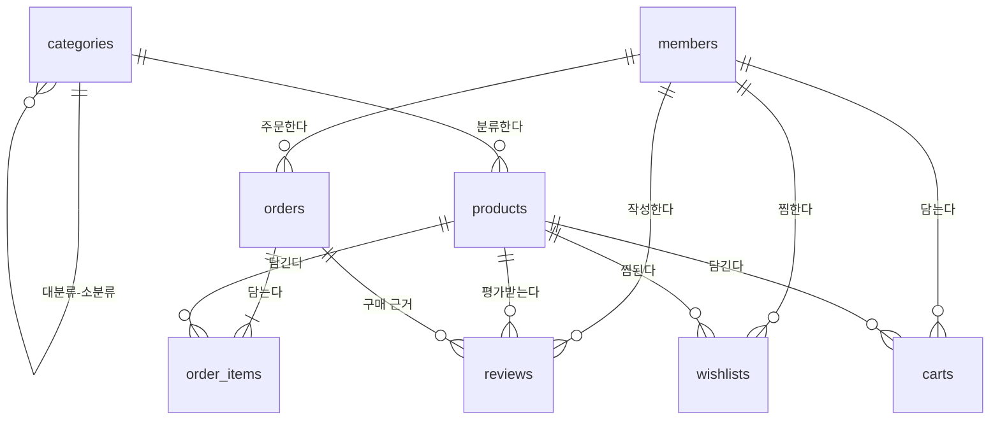

# 한입마켓 연습문제 — 쇼핑몰 DB로 푸는 20문제

> **복습 문제집** | Ch04 집계 · Ch05 JOIN · Ch06 서브쿼리 · 윈도우 함수 + UNION
> 한입배달과는 **다른 DB**(`hanip_market`)라서 수업 예제를 외운 답으로는 풀 수 없습니다. 같은 기술을 새로운 데이터에 적용하는 연습입니다.

## 시작하기

1. 이 폴더의 **`setup.sql`**을 Workbench에서 열고 전체 실행(`Ctrl+Shift+Enter`)
2. 마지막에 테이블별 행 수가 나오면 성공
3. **[practice.md](practice.md)** 를 열고 문제를 풉니다. 문제마다 **기대 결과**가 있으니 내 결과와 비교하세요.
4. 막히거나 다 풀었으면 **[answers.md](answers.md)** (정답 SQL + 해설), 정답만 한 번에 실행하려면 **[answers.sql](answers.sql)**

```sql
USE hanip_market;
SHOW TABLES;
```

> 데이터를 처음 상태로 되돌리려면 `setup.sql` 맨 위의 `-- DROP DATABASE IF EXISTS hanip_market;` 줄에서 `-- `를 지우고 다시 전체 실행하세요. (문제는 모두 조회만 하므로 보통은 필요 없습니다.)

## 문제 구성

| PART | 문제 | 주제 |
|---|---|---|
| A. JOIN + GROUP BY | 1 ~ 6 | 셀프 조인, LEFT JOIN 전환율, HAVING, 피벗, 팔리지 않은 상품, 2단계 집계 |
| B. 서브쿼리 | 7 ~ 11 | 상관 서브쿼리, NOT EXISTS, 스칼라 서브쿼리 + CTE, 다중 열 IN, 3중 서브쿼리 |
| C. 윈도우 함수 | 12 ~ 16 | RANK 그룹별 TOP N, LAG 전월 대비, 누적 합, ROW_NUMBER 첫 구매, NTILE |
| D. UNION | 17 ~ 20 | 두 테이블 합치기, 활동 타임라인, UNION vs UNION ALL, 합계 행 리포트 |

난이도 ★ 3문제 · ★★ 13문제 · ★★★ 4문제. 수업 시간이라면 PART별로 나눠 40분씩, 과제라면 한 번에.

## DB 구조

한입배달의 자매 서비스 **한입마켓** — 패션 · 디지털 · 식품 · 생활용품을 파는 온라인 쇼핑몰입니다. 기준 시점은 **2026-06-30 18:00**, 주문 기간은 2026년 1~6월입니다.



| 테이블 | 행 | 설명 |
|---|---|---|
| `categories` | 16 | 대분류 4(`parent_id` NULL) + 소분류 12. **자기 자신을 참조**(셀프 조인 연습) |
| `products` | 42 | 상품. `price`는 **현재가**, `is_active`는 판매 중 여부 |
| `members` | 40 | 현재 회원. 지역 · 출생 연도 · 가입 일시 |
| `withdrawn_members` | 6 | **탈퇴 회원**은 별도 테이블에 보관 (UNION 연습) |
| `orders` | 301 | 주문. 상태 `결제완료 · 배송중 · 배송완료 · 취소 · 반품`, 결제수단, 배송비, 쿠폰 할인 |
| `order_items` | 491 | 주문 상세. `unit_price` = **주문 당시** 단가 |
| `reviews` | 152 | 배송완료 주문 상품의 리뷰 (별점 1~5) |
| `wishlists` | 74 | 찜 목록 |
| `carts` | 41 | 지금 장바구니에 담긴 상품 |

**금액 계산 약속** (모든 문제 공통)

- **매출** = `SUM(quantity * unit_price)`, **배송완료** 주문만
- **결제액(주문 금액)** = 그 주문의 상품 합계 + `shipping_fee` − `coupon_discount` (배송비는 상품 합계 3만 원 이상이면 0원)

## 데이터 특징 (문제에 숨어 있는 것들)

| 특징 | 관련 문제 |
|---|---|
| 주문이 **한 번도 없는** 회원 3명, 주문은 했지만 **전부 취소**한 회원 1명 | 2 (LEFT JOIN 전환율) |
| 한 번도 주문되지 않은 상품, 주문은 됐지만 **전부 취소 · 반품**된 상품 | 5 |
| 4월 1일에 일부 상품 가격 인상 → `unit_price`와 `price`가 다른 주문이 있음 | 매출은 항상 `unit_price`로 |
| 리뷰 평균이 눈에 띄게 낮은 브랜드 | 3 |
| 2월(설 연휴) 주문 감소, 5월(가정의 달) 최고 | 4 · 13 |
| 6월은 아직 배송 중 · 결제완료 주문이 많아 **배송완료 매출이 덜 잡힘** | 13 (마감 안 된 달 비교의 함정) |
| 찜과 장바구니에 **동시에** 있는 상품 | 19 |

## 수업에서 쓰는 법 (강사용)

- 정답 결과는 정답 SQL을 실제로 실행해 만든 것입니다. 학생 결과가 다르면 **행 수 → 첫 행 → 정렬** 순으로 비교하게 하세요.
- 같은 문제에 정답 쿼리가 여러 개일 수 있습니다(JOIN ↔ 서브쿼리 ↔ 윈도우 함수). 결과가 같다면 정답이고, 해설에 대안을 일부 적어 두었습니다.
- 데이터는 `tools/gen_drill_market.py`가 고정 시드로 만듭니다. 문제를 바꾸면 `python3 tools/build_drill.py shopping-mall`로 기대 결과를 다시 생성합니다.
